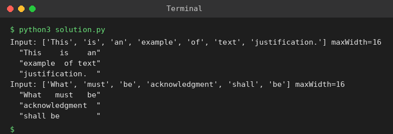

# Exp 56: Text Justification

## Aim
To format words into lines of exactly maxWidth characters, fully justified (last line left-justified).

## Algorithm
1. Greedily pack as many words as fit in a line
2. If the line is the last one or has one word, left-justify and pad with spaces on the right
3. Otherwise distribute the spaces evenly between words, giving extra spaces to the left gaps
4. Collect all lines

## Input
```
words = ["This","is","an","example","of","text","justification."], maxWidth = 16
words = ["What","must","be","acknowledgment","shall","be"], maxWidth = 16
```

## Program
[`solution.py`](solution.py)

```python
def full_justify(words, W):
    res, i = [], 0
    while i < len(words):
        j, length = i, 0
        while j < len(words) and length + len(words[j]) + (j - i) <= W:
            length += len(words[j])
            j += 1
        line, gaps = words[i:j], j - i - 1
        if j == len(words) or gaps == 0:
            s = " ".join(line)
            s += " " * (W - len(s))
        else:
            q, r = divmod(W - length, gaps)
            s = "".join(w + " " * (q + (1 if g < r else 0)) for g, w in enumerate(line[:-1])) + line[-1]
        res.append(s)
        i = j
    return res

for words in (["This", "is", "an", "example", "of", "text", "justification."],
              ["What", "must", "be", "acknowledgment", "shall", "be"]):
    print("Input:", words, "maxWidth=16")
    for line in full_justify(words, 16):
        print(f'  "{line}"')
```

## Output
```
Input: ['This', 'is', 'an', 'example', 'of', 'text', 'justification.'] maxWidth=16
  "This    is    an"
  "example  of text"
  "justification.  "
Input: ['What', 'must', 'be', 'acknowledgment', 'shall', 'be'] maxWidth=16
  "What   must   be"
  "acknowledgment  "
  "shall be        "
```

## Screenshot


## Result
The program for **Text Justification** was implemented and executed successfully, and the output shown above was obtained for all the given test cases.

## Time and Space Complexity
| | Complexity |
|---|---|
| **Time** | O(total characters) |
| **Space** | O(total characters) |
