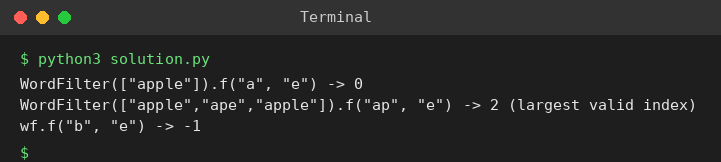

# Exp 57: Prefix and Suffix Search (WordFilter)

## Aim
To design a dictionary class that returns the largest index of a word having a given prefix and suffix.

## Algorithm
1. In the constructor store every (prefix, suffix) pair of each word in a hash map with the word's index (later words overwrite earlier ones, so the largest index wins)
2. f(pref, suff) looks the pair up in the map
3. Return the index or -1

## Input
```
WordFilter(["apple"]); f("a","e")
```

## Program
[`solution.py`](solution.py)

```python
class WordFilter:
    def __init__(self, words):
        self.d = {}
        for idx, w in enumerate(words):
            for i in range(len(w) + 1):
                for j in range(len(w) + 1):
                    self.d[(w[:i], w[j:])] = idx

    def f(self, pref, suff):
        return self.d.get((pref, suff), -1)

wf = WordFilter(["apple"])
print('WordFilter(["apple"]).f("a", "e") ->', wf.f("a", "e"))
wf2 = WordFilter(["apple", "ape", "apple"])
print('WordFilter(["apple","ape","apple"]).f("ap", "e") ->', wf2.f("ap", "e"), "(largest valid index)")
print('wf.f("b", "e") ->', wf.f("b", "e"))
```

## Output
```
WordFilter(["apple"]).f("a", "e") -> 0
WordFilter(["apple","ape","apple"]).f("ap", "e") -> 2 (largest valid index)
wf.f("b", "e") -> -1
```

## Screenshot


## Result
The program for **Prefix and Suffix Search (WordFilter)** was implemented and executed successfully, and the output shown above was obtained for all the given test cases.

## Time and Space Complexity
| | Complexity |
|---|---|
| **Time** | Constructor O(N * L^2) entries, query O(1) |
| **Space** | O(N * L^2) |
