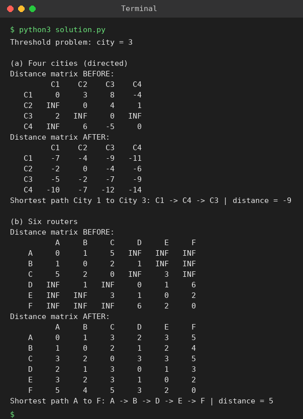

# Exp 58: Floyd-Warshall: All-Pairs Shortest Paths

## Aim
To implement Floyd's algorithm, show the distance matrix before and after, and print the shortest path (also solving the distance-threshold city problem).

## Algorithm
1. Initialise the matrix with edge weights, 0 on the diagonal and infinity elsewhere
2. For every intermediate vertex k and every pair (i, j) relax d[i][j] = min(d[i][j], d[i][k] + d[k][j])
3. Keep a 'next' matrix to rebuild the paths
4. Print the matrices and the required path

## Input
```
n=4, edges=[[0,1,3],[1,2,1],[1,3,4],[2,3,1]], distanceThreshold=4
(a) City1->2:3, 1->3:8, 1->4:-4, 2->4:1, 2->3:4, 3->1:2, 4->3:-5, 4->2:6 (directed)
(b) Routers A-B 1, A-C 5, B-C 2, B-D 1, C-E 3, D-E 1, D-F 6, E-F 2
```

## Program
[`solution.py`](solution.py)

```python
INF = float("inf")

def floyd(n, edges, directed=False):
    d = [[INF] * n for _ in range(n)]
    nxt = [[None] * n for _ in range(n)]
    for i in range(n):
        d[i][i] = 0
    for u, v, w in edges:
        d[u][v] = w; nxt[u][v] = v
        if not directed:
            d[v][u] = w; nxt[v][u] = u
    before = [r[:] for r in d]
    for k in range(n):
        for i in range(n):
            for j in range(n):
                if d[i][k] + d[k][j] < d[i][j]:
                    d[i][j] = d[i][k] + d[k][j]
                    nxt[i][j] = nxt[i][k]
    return before, d, nxt

def path(nxt, u, v):
    if nxt[u][v] is None:
        return []
    p = [u]
    while u != v:
        u = nxt[u][v]
        p.append(u)
    return p

def show(m, title, names):
    print(title)
    print("      " + " ".join(f"{x:>5}" for x in names))
    for i, row in enumerate(m):
        print(f"{names[i]:>5} " + " ".join(f"{'INF' if v == INF else v:>5}" for v in row))

def find_city(n, edges, thr):
    _, d, _ = floyd(n, edges)
    best, ans = None, -1
    for i in range(n):
        c = sum(1 for j in range(n) if i != j and d[i][j] <= thr)
        if best is None or c <= best:
            best, ans = c, i
    return ans

print("Threshold problem: city =", find_city(4, [[0, 1, 3], [1, 2, 1], [1, 3, 4], [2, 3, 1]], 4))

print("\n(a) Four cities (directed)")
E = [(0, 1, 3), (0, 2, 8), (0, 3, -4), (1, 3, 1), (1, 2, 4), (2, 0, 2), (3, 2, -5), (3, 1, 6)]
names = ["C1", "C2", "C3", "C4"]
b, d, nxt = floyd(4, E, directed=True)
show(b, "Distance matrix BEFORE:", names)
show(d, "Distance matrix AFTER:", names)
p = path(nxt, 0, 2)
print("Shortest path City 1 to City 3:", " -> ".join(names[i] for i in p), "| distance =", d[0][2])

print("\n(b) Six routers")
names = list("ABCDEF")
R = [(0, 1, 1), (0, 2, 5), (1, 2, 2), (1, 3, 1), (2, 4, 3), (3, 4, 1), (3, 5, 6), (4, 5, 2)]
b, d, nxt = floyd(6, R)
show(b, "Distance matrix BEFORE:", names)
show(d, "Distance matrix AFTER:", names)
p = path(nxt, 0, 5)
print("Shortest path A to F:", " -> ".join(names[i] for i in p), "| distance =", d[0][5])
```

## Output
```
Threshold problem: city = 3

(a) Four cities (directed)
Distance matrix BEFORE:
         C1    C2    C3    C4
   C1     0     3     8    -4
   C2   INF     0     4     1
   C3     2   INF     0   INF
   C4   INF     6    -5     0
Distance matrix AFTER:
         C1    C2    C3    C4
   C1    -7    -4    -9   -11
   C2    -2     0    -4    -6
   C3    -5    -2    -7    -9
   C4   -10    -7   -12   -14
Shortest path City 1 to City 3: C1 -> C4 -> C3 | distance = -9

(b) Six routers
Distance matrix BEFORE:
          A     B     C     D     E     F
    A     0     1     5   INF   INF   INF
    B     1     0     2     1   INF   INF
    C     5     2     0   INF     3   INF
    D   INF     1   INF     0     1     6
    E   INF   INF     3     1     0     2
    F   INF   INF   INF     6     2     0
Distance matrix AFTER:
          A     B     C     D     E     F
    A     0     1     3     2     3     5
    B     1     0     2     1     2     4
    C     3     2     0     3     3     5
    D     2     1     3     0     1     3
    E     3     2     3     1     0     2
    F     5     4     5     3     2     0
Shortest path A to F: A -> B -> D -> E -> F | distance = 5
```

## Screenshot


## Result
The program for **Floyd-Warshall: All-Pairs Shortest Paths** was implemented and executed successfully, and the output shown above was obtained for all the given test cases.

> **Note:** Part (a) contains a negative cycle (C1 -> C4 -> C3 -> C1 = -4 - 5 + 2 = -7), which Floyd-Warshall reveals as negative values on the diagonal. The requested City 1 to City 3 distance of -9 (C1 -> C4 -> C3) is reported as expected; distances of vertices lying on the negative cycle are not meaningful.

## Time and Space Complexity
| | Complexity |
|---|---|
| **Time** | O(V^3) |
| **Space** | O(V^2) |
