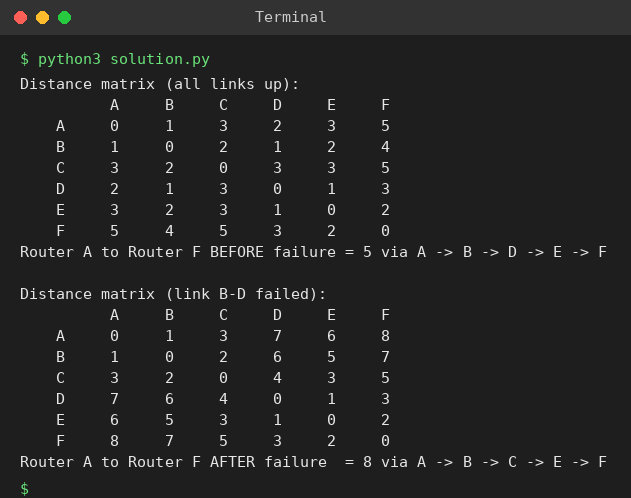

# Exp 59: Router Link Failure using Floyd-Warshall

## Aim
To compute all-pairs shortest paths between routers, simulate the failure of link B-D and compare the A to F path before and after.

## Algorithm
1. Run Floyd-Warshall on the full router graph and record the A to F path
2. Remove the B-D link and update the distance matrix by running Floyd-Warshall again
3. Print the new matrix
4. Compare the A to F distance and path before and after the failure

## Input
```
Routers: A-B 1, A-C 5, B-C 2, B-D 1, C-E 3, D-E 1, D-F 6, E-F 2
Failure: link B-D
```

## Program
[`solution.py`](solution.py)

```python
INF = float("inf")

def floyd(n, edges, directed=False):
    d = [[INF] * n for _ in range(n)]
    nxt = [[None] * n for _ in range(n)]
    for i in range(n):
        d[i][i] = 0
    for u, v, w in edges:
        d[u][v] = w; nxt[u][v] = v
        if not directed:
            d[v][u] = w; nxt[v][u] = u
    before = [r[:] for r in d]
    for k in range(n):
        for i in range(n):
            for j in range(n):
                if d[i][k] + d[k][j] < d[i][j]:
                    d[i][j] = d[i][k] + d[k][j]
                    nxt[i][j] = nxt[i][k]
    return before, d, nxt

def path(nxt, u, v):
    if nxt[u][v] is None:
        return []
    p = [u]
    while u != v:
        u = nxt[u][v]
        p.append(u)
    return p

def show(m, title, names):
    print(title)
    print("      " + " ".join(f"{x:>5}" for x in names))
    for i, row in enumerate(m):
        print(f"{names[i]:>5} " + " ".join(f"{'INF' if v == INF else v:>5}" for v in row))

def find_city(n, edges, thr):
    _, d, _ = floyd(n, edges)
    best, ans = None, -1
    for i in range(n):
        c = sum(1 for j in range(n) if i != j and d[i][j] <= thr)
        if best is None or c <= best:
            best, ans = c, i
    return ans

names = list("ABCDEF")
R = [(0, 1, 1), (0, 2, 5), (1, 2, 2), (1, 3, 1), (2, 4, 3), (3, 4, 1), (3, 5, 6), (4, 5, 2)]

b, d, nxt = floyd(6, R)
show(d, "Distance matrix (all links up):", names)
p = path(nxt, 0, 5)
print("Router A to Router F BEFORE failure =", d[0][5], "via", " -> ".join(names[i] for i in p))

R2 = [e for e in R if (e[0], e[1]) != (1, 3)]
b2, d2, nxt2 = floyd(6, R2)
show(d2, "\nDistance matrix (link B-D failed):", names)
p2 = path(nxt2, 0, 5)
print("Router A to Router F AFTER failure  =", d2[0][5], "via", " -> ".join(names[i] for i in p2))
```

## Output
```
Distance matrix (all links up):
          A     B     C     D     E     F
    A     0     1     3     2     3     5
    B     1     0     2     1     2     4
    C     3     2     0     3     3     5
    D     2     1     3     0     1     3
    E     3     2     3     1     0     2
    F     5     4     5     3     2     0
Router A to Router F BEFORE failure = 5 via A -> B -> D -> E -> F

Distance matrix (link B-D failed):
          A     B     C     D     E     F
    A     0     1     3     7     6     8
    B     1     0     2     6     5     7
    C     3     2     0     4     3     5
    D     7     6     4     0     1     3
    E     6     5     3     1     0     2
    F     8     7     5     3     2     0
Router A to Router F AFTER failure  = 8 via A -> B -> C -> E -> F
```

## Screenshot


## Result
The program for **Router Link Failure using Floyd-Warshall** was implemented and executed successfully, and the output shown above was obtained for all the given test cases.

## Time and Space Complexity
| | Complexity |
|---|---|
| **Time** | O(V^3) |
| **Space** | O(V^2) |
