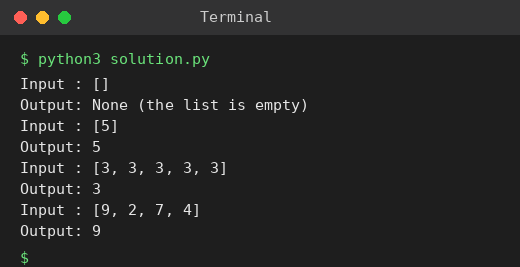

# Exp 6: Sort a List and Find the Maximum

## Aim
To sort a list with an efficient sorting algorithm (Merge Sort) and then find the maximum element.

## Algorithm
1. If the list is empty return None
2. Sort the list with Merge Sort (divide, sort halves, merge)
3. The maximum is the last element of the sorted list
4. Return it

## Input
```
[]
[5]
[3,3,3,3,3]
```

## Program
[`solution.py`](solution.py)

```python
def merge_sort(a):
    if len(a) <= 1:
        return a
    mid = len(a) // 2
    l, r = merge_sort(a[:mid]), merge_sort(a[mid:])
    out, i, j = [], 0, 0
    while i < len(l) and j < len(r):
        if l[i] <= r[j]:
            out.append(l[i]); i += 1
        else:
            out.append(r[j]); j += 1
    return out + l[i:] + r[j:]

def max_after_sort(a):
    if not a:
        return None
    return merge_sort(a)[-1]

for a in ([], [5], [3, 3, 3, 3, 3], [9, 2, 7, 4]):
    res = max_after_sort(a)
    print("Input :", a)
    print("Output:", res if res is not None else "None (the list is empty)")
```

## Output
```
Input : []
Output: None (the list is empty)
Input : [5]
Output: 5
Input : [3, 3, 3, 3, 3]
Output: 3
Input : [9, 2, 7, 4]
Output: 9
```

## Screenshot


## Result
The program for **Sort a List and Find the Maximum** was implemented and executed successfully, and the output shown above was obtained for all the given test cases.

## Time and Space Complexity
| | Complexity |
|---|---|
| **Time** | O(n log n) |
| **Space** | O(n) |
