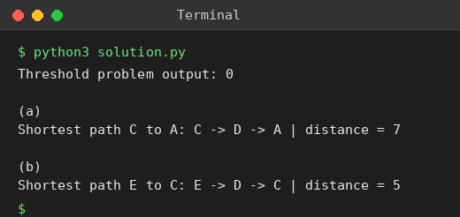

# Exp 60: Floyd-Warshall: Threshold City and Shortest Paths

## Aim
To apply Floyd's algorithm to find the city with the fewest reachable neighbours within a threshold and to find shortest paths in directed networks.

## Algorithm
1. Run Floyd-Warshall to obtain all-pairs distances
2. For each city count the cities within distanceThreshold
3. Return the city with the smallest count (largest index on ties)
4. Use the distance and next matrices for the shortest path queries

## Input
```
n=5, edges=[[0,1,2],[0,4,8],[1,2,3],[1,4,2],[2,3,1],[3,4,1]], distanceThreshold=2
(a) B->A 2, A->C 3, C->D 1, D->A 6, C->B 7 : path C to A
(b) C->A 2, A->B 4, B->C 1, B->E 6, E->A 1, A->D 5, D->E 2, E->D 4, D->C 1, C->D 3 : path E to C
```

## Program
[`solution.py`](solution.py)

```python
INF = float("inf")

def floyd(n, edges, directed=False):
    d = [[INF] * n for _ in range(n)]
    nxt = [[None] * n for _ in range(n)]
    for i in range(n):
        d[i][i] = 0
    for u, v, w in edges:
        d[u][v] = w; nxt[u][v] = v
        if not directed:
            d[v][u] = w; nxt[v][u] = u
    before = [r[:] for r in d]
    for k in range(n):
        for i in range(n):
            for j in range(n):
                if d[i][k] + d[k][j] < d[i][j]:
                    d[i][j] = d[i][k] + d[k][j]
                    nxt[i][j] = nxt[i][k]
    return before, d, nxt

def path(nxt, u, v):
    if nxt[u][v] is None:
        return []
    p = [u]
    while u != v:
        u = nxt[u][v]
        p.append(u)
    return p

def show(m, title, names):
    print(title)
    print("      " + " ".join(f"{x:>5}" for x in names))
    for i, row in enumerate(m):
        print(f"{names[i]:>5} " + " ".join(f"{'INF' if v == INF else v:>5}" for v in row))

def find_city(n, edges, thr):
    _, d, _ = floyd(n, edges)
    best, ans = None, -1
    for i in range(n):
        c = sum(1 for j in range(n) if i != j and d[i][j] <= thr)
        if best is None or c <= best:
            best, ans = c, i
    return ans

E = [[0, 1, 2], [0, 4, 8], [1, 2, 3], [1, 4, 2], [2, 3, 1], [3, 4, 1]]
print("Threshold problem output:", find_city(5, E, 2))

def query(edges_txt, src, dst):
    names = sorted({x for e in edges_txt for x in e[:2]})
    idx = {c: i for i, c in enumerate(names)}
    edges = [(idx[a], idx[b], w) for a, b, w in edges_txt]
    b, d, nxt = floyd(len(names), edges, directed=True)
    p = path(nxt, idx[src], idx[dst])
    print(f"Shortest path {src} to {dst}: {' -> '.join(names[i] for i in p)} | distance = {d[idx[src]][idx[dst]]}")

print("\n(a)")
query([("B", "A", 2), ("A", "C", 3), ("C", "D", 1), ("D", "A", 6), ("C", "B", 7)], "C", "A")
print("\n(b)")
query([("C", "A", 2), ("A", "B", 4), ("B", "C", 1), ("B", "E", 6), ("E", "A", 1), ("A", "D", 5),
       ("D", "E", 2), ("E", "D", 4), ("D", "C", 1), ("C", "D", 3)], "E", "C")
```

## Output
```
Threshold problem output: 0

(a)
Shortest path C to A: C -> D -> A | distance = 7

(b)
Shortest path E to C: E -> D -> C | distance = 5
```

## Screenshot


## Result
The program for **Floyd-Warshall: Threshold City and Shortest Paths** was implemented and executed successfully, and the output shown above was obtained for all the given test cases.

## Time and Space Complexity
| | Complexity |
|---|---|
| **Time** | O(V^3) |
| **Space** | O(V^2) |
