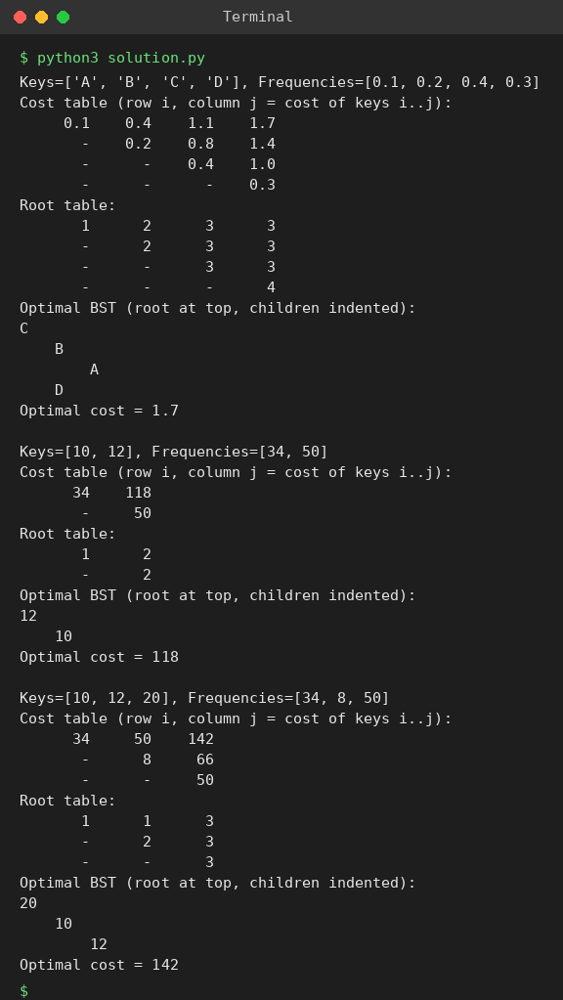

# Exp 61: Optimal Binary Search Tree (Keys A, B, C, D)

## Aim
To construct an optimal binary search tree for keys A, B, C, D with given frequencies and print its cost and root matrices.

## Algorithm
1. cost[i][j] = minimum cost of a BST on keys i..j
2. For every chain length and every root r in i..j: cost = cost[i][r-1] + cost[r+1][j] + sum(freq[i..j])
3. Store the best root in root[i][j]
4. Build the tree from root[1][n] and print the tables

## Input
```
Keys = {A,B,C,D}, Frequencies = {0.1, 0.2, 0.4, 0.3}
keys {10,12}, freq {34,50}
keys {10,12,20}, freq {34,8,50}
```

## Program
[`solution.py`](solution.py)

```python
def obst(keys, freq):
    n = len(keys)
    cost = [[0] * (n + 2) for _ in range(n + 2)]
    root = [[0] * (n + 2) for _ in range(n + 2)]
    for i in range(1, n + 1):
        cost[i][i], root[i][i] = freq[i - 1], i
    for L in range(2, n + 1):
        for i in range(1, n - L + 2):
            j = i + L - 1
            s = sum(freq[i - 1:j])
            cost[i][j] = float("inf")
            for r in range(i, j + 1):
                c = cost[i][r - 1] + cost[r + 1][j] + s
                if c < cost[i][j]:
                    cost[i][j], root[i][j] = c, r
    return cost, root

def show_tree(keys, root, i, j, indent=0):
    if i > j:
        return
    r = root[i][j]
    print(" " * indent + str(keys[r - 1]))
    show_tree(keys, root, i, r - 1, indent + 4)
    show_tree(keys, root, r + 1, j, indent + 4)

def report(keys, freq):
    n = len(keys)
    cost, root = obst(keys, freq)
    print(f"Keys={keys}, Frequencies={freq}")
    print("Cost table (row i, column j = cost of keys i..j):")
    for i in range(1, n + 1):
        print("  " + " ".join(f"{round(cost[i][j], 2) if j >= i else '-':>6}" for j in range(1, n + 1)))
    print("Root table:")
    for i in range(1, n + 1):
        print("  " + " ".join(f"{root[i][j] if j >= i else '-':>6}" for j in range(1, n + 1)))
    print("Optimal BST (root at top, children indented):")
    show_tree(keys, root, 1, n)
    print("Optimal cost =", round(cost[1][n], 2), "\n")

report(["A", "B", "C", "D"], [0.1, 0.2, 0.4, 0.3])
report([10, 12], [34, 50])
report([10, 12, 20], [34, 8, 50])
```

## Output
```
Keys=['A', 'B', 'C', 'D'], Frequencies=[0.1, 0.2, 0.4, 0.3]
Cost table (row i, column j = cost of keys i..j):
     0.1    0.4    1.1    1.7
       -    0.2    0.8    1.4
       -      -    0.4    1.0
       -      -      -    0.3
Root table:
       1      2      3      3
       -      2      3      3
       -      -      3      3
       -      -      -      4
Optimal BST (root at top, children indented):
C
    B
        A
    D
Optimal cost = 1.7 

Keys=[10, 12], Frequencies=[34, 50]
Cost table (row i, column j = cost of keys i..j):
      34    118
       -     50
Root table:
       1      2
       -      2
Optimal BST (root at top, children indented):
12
    10
Optimal cost = 118 

Keys=[10, 12, 20], Frequencies=[34, 8, 50]
Cost table (row i, column j = cost of keys i..j):
      34     50    142
       -      8     66
       -      -     50
Root table:
       1      1      3
       -      2      3
       -      -      3
Optimal BST (root at top, children indented):
20
    10
        12
Optimal cost = 142
```

## Screenshot


## Result
The program for **Optimal Binary Search Tree (Keys A, B, C, D)** was implemented and executed successfully, and the output shown above was obtained for all the given test cases.

## Time and Space Complexity
| | Complexity |
|---|---|
| **Time** | O(n^3) |
| **Space** | O(n^2) |
