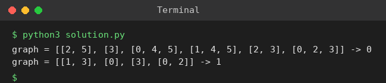

# Exp 63: Cat and Mouse Game

## Aim
To determine the winner (1 = mouse, 2 = cat, 0 = draw) of the cat and mouse game on an undirected graph when both play optimally.

## Algorithm
1. State = (mouse node, cat node, whose turn)
2. Terminal states: mouse at hole 0 = mouse wins; cat on mouse = cat wins
3. Process states backwards with a queue (retrograde analysis): a state is won by the mover if some move reaches a state it wins, lost if all moves lead to states the opponent wins
4. States never decided are draws
5. Answer is the colour of (1, 2, mouse's turn)

## Input
```
graph = [[2,5],[3],[0,4,5],[1,4,5],[2,3],[0,2,3]]
graph = [[1,3],[0],[3],[0,2]]
```

## Program
[`solution.py`](solution.py)

```python
from collections import deque

def cat_mouse(graph):
    n = len(graph)
    MOUSE, CAT = 1, 2
    color = [[[0] * 2 for _ in range(n)] for _ in range(n)]      # [mouse][cat][turn], turn 0 = mouse
    degree = [[[0] * 2 for _ in range(n)] for _ in range(n)]
    for m in range(n):
        for c in range(n):
            degree[m][c][0] = len(graph[m])
            degree[m][c][1] = len(graph[c]) - (0 in graph[c])
    q = deque()
    for c in range(1, n):
        for t in range(2):
            color[0][c][t] = MOUSE; q.append((0, c, t, MOUSE))
            color[c][c][t] = CAT;   q.append((c, c, t, CAT))
    while q:
        m, c, t, col = q.popleft()
        if t == 1:      # previous mover was the mouse
            parents = [(pm, c, 0) for pm in graph[m]]
        else:           # previous mover was the cat
            parents = [(m, pc, 1) for pc in graph[c] if pc != 0]
        for pm, pc, pt in parents:
            if color[pm][pc][pt]:
                continue
            if (pt == 0 and col == MOUSE) or (pt == 1 and col == CAT):
                color[pm][pc][pt] = col
                q.append((pm, pc, pt, col))
            else:
                degree[pm][pc][pt] -= 1
                if degree[pm][pc][pt] == 0:
                    color[pm][pc][pt] = col
                    q.append((pm, pc, pt, col))
    return color[1][2][0]

for g in ([[2, 5], [3], [0, 4, 5], [1, 4, 5], [2, 3], [0, 2, 3]], [[1, 3], [0], [3], [0, 2]]):
    print("graph =", g, "->", cat_mouse(g))
```

## Output
```
graph = [[2, 5], [3], [0, 4, 5], [1, 4, 5], [2, 3], [0, 2, 3]] -> 0
graph = [[1, 3], [0], [3], [0, 2]] -> 1
```

## Screenshot


## Result
The program for **Cat and Mouse Game** was implemented and executed successfully, and the output shown above was obtained for all the given test cases.

## Time and Space Complexity
| | Complexity |
|---|---|
| **Time** | O(n^3) |
| **Space** | O(n^2) |
