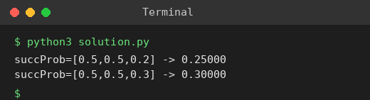

# Exp 64: Path with Maximum Probability

## Aim
To find the path with the maximum success probability between two nodes of an undirected weighted graph.

## Algorithm
1. Build the adjacency list with edge probabilities
2. Run Dijkstra with a max-heap on the product of probabilities (start = 1.0)
3. Relax: new = prob[u] * p(u, v); update if larger
4. Return the probability of the end node (0 if unreachable)

## Input
```
n=3, edges=[[0,1],[1,2],[0,2]], succProb=[0.5,0.5,0.2], start=0, end=2
succProb=[0.5,0.5,0.3]
```

## Program
[`solution.py`](solution.py)

```python
import heapq

def max_probability(n, edges, succ, start, end):
    g = [[] for _ in range(n)]
    for (a, b), p in zip(edges, succ):
        g[a].append((b, p))
        g[b].append((a, p))
    best = [0.0] * n
    best[start] = 1.0
    pq = [(-1.0, start)]
    while pq:
        p, u = heapq.heappop(pq)
        p = -p
        if u == end:
            return p
        if p < best[u]:
            continue
        for v, w in g[u]:
            if p * w > best[v]:
                best[v] = p * w
                heapq.heappush(pq, (-best[v], v))
    return 0.0

E = [[0, 1], [1, 2], [0, 2]]
print("succProb=[0.5,0.5,0.2] ->", f"{max_probability(3, E, [0.5, 0.5, 0.2], 0, 2):.5f}")
print("succProb=[0.5,0.5,0.3] ->", f"{max_probability(3, E, [0.5, 0.5, 0.3], 0, 2):.5f}")
```

## Output
```
succProb=[0.5,0.5,0.2] -> 0.25000
succProb=[0.5,0.5,0.3] -> 0.30000
```

## Screenshot


## Result
The program for **Path with Maximum Probability** was implemented and executed successfully, and the output shown above was obtained for all the given test cases.

## Time and Space Complexity
| | Complexity |
|---|---|
| **Time** | O(E log V) |
| **Space** | O(V + E) |
