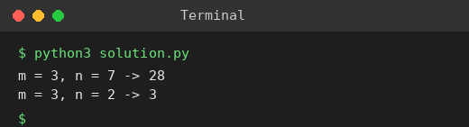

# Exp 65: Unique Paths (Grid DP)

## Aim
To count the unique paths from the top-left to the bottom-right of an m x n grid when moving only right or down.

## Algorithm
1. dp[i][j] = number of paths to cell (i, j)
2. First row and column are 1
3. dp[i][j] = dp[i-1][j] + dp[i][j-1]
4. Return dp[m-1][n-1]

## Input
```
m = 3, n = 7
m = 3, n = 2
```

## Program
[`solution.py`](solution.py)

```python
def unique_paths(m, n):
    dp = [[1] * n for _ in range(m)]
    for i in range(1, m):
        for j in range(1, n):
            dp[i][j] = dp[i - 1][j] + dp[i][j - 1]
    return dp[m - 1][n - 1]

for m, n in ((3, 7), (3, 2)):
    print(f"m = {m}, n = {n} -> {unique_paths(m, n)}")
```

## Output
```
m = 3, n = 7 -> 28
m = 3, n = 2 -> 3
```

## Screenshot


## Result
The program for **Unique Paths (Grid DP)** was implemented and executed successfully, and the output shown above was obtained for all the given test cases.

## Time and Space Complexity
| | Complexity |
|---|---|
| **Time** | O(m * n) |
| **Space** | O(m * n) |
