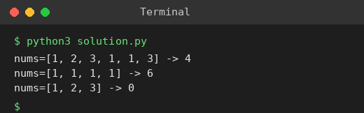

# Exp 66: Number of Good Pairs

## Aim
To count the pairs (i, j), i < j, with nums[i] == nums[j].

## Algorithm
1. Count the occurrences c of every value with a hash map
2. Each value with c occurrences contributes c*(c-1)/2 pairs
3. Add the contributions
4. Return the total

## Input
```
nums = [1,2,3,1,1,3]
nums = [1,1,1,1]
```

## Program
[`solution.py`](solution.py)

```python
from collections import Counter

def num_identical_pairs(nums):
    return sum(c * (c - 1) // 2 for c in Counter(nums).values())

for nums in ([1, 2, 3, 1, 1, 3], [1, 1, 1, 1], [1, 2, 3]):
    print(f"nums={nums} -> {num_identical_pairs(nums)}")
```

## Output
```
nums=[1, 2, 3, 1, 1, 3] -> 4
nums=[1, 1, 1, 1] -> 6
nums=[1, 2, 3] -> 0
```

## Screenshot


## Result
The program for **Number of Good Pairs** was implemented and executed successfully, and the output shown above was obtained for all the given test cases.

## Time and Space Complexity
| | Complexity |
|---|---|
| **Time** | O(n) |
| **Space** | O(n) |
