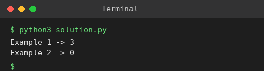

# Exp 67: City with the Smallest Number of Neighbours at a Threshold Distance

## Aim
To find the city that can reach the fewest cities within distanceThreshold (largest index on ties).

## Algorithm
1. Compute all-pairs shortest paths with Floyd-Warshall
2. For each city count the cities whose distance is <= threshold
3. Choose the city with the smallest count, preferring the greater index on ties
4. Return it

## Input
```
n=4, edges=[[0,1,3],[1,2,1],[1,3,4],[2,3,1]], distanceThreshold=4
n=5, edges=[[0,1,2],[0,4,8],[1,2,3],[1,4,2],[2,3,1],[3,4,1]], distanceThreshold=2
```

## Program
[`solution.py`](solution.py)

```python
INF = float("inf")

def floyd(n, edges, directed=False):
    d = [[INF] * n for _ in range(n)]
    nxt = [[None] * n for _ in range(n)]
    for i in range(n):
        d[i][i] = 0
    for u, v, w in edges:
        d[u][v] = w; nxt[u][v] = v
        if not directed:
            d[v][u] = w; nxt[v][u] = u
    before = [r[:] for r in d]
    for k in range(n):
        for i in range(n):
            for j in range(n):
                if d[i][k] + d[k][j] < d[i][j]:
                    d[i][j] = d[i][k] + d[k][j]
                    nxt[i][j] = nxt[i][k]
    return before, d, nxt

def path(nxt, u, v):
    if nxt[u][v] is None:
        return []
    p = [u]
    while u != v:
        u = nxt[u][v]
        p.append(u)
    return p

def show(m, title, names):
    print(title)
    print("      " + " ".join(f"{x:>5}" for x in names))
    for i, row in enumerate(m):
        print(f"{names[i]:>5} " + " ".join(f"{'INF' if v == INF else v:>5}" for v in row))

def find_city(n, edges, thr):
    _, d, _ = floyd(n, edges)
    best, ans = None, -1
    for i in range(n):
        c = sum(1 for j in range(n) if i != j and d[i][j] <= thr)
        if best is None or c <= best:
            best, ans = c, i
    return ans

print("Example 1 ->", find_city(4, [[0, 1, 3], [1, 2, 1], [1, 3, 4], [2, 3, 1]], 4))
print("Example 2 ->", find_city(5, [[0, 1, 2], [0, 4, 8], [1, 2, 3], [1, 4, 2], [2, 3, 1], [3, 4, 1]], 2))
```

## Output
```
Example 1 -> 3
Example 2 -> 0
```

## Screenshot


## Result
The program for **City with the Smallest Number of Neighbours at a Threshold Distance** was implemented and executed successfully, and the output shown above was obtained for all the given test cases.

## Time and Space Complexity
| | Complexity |
|---|---|
| **Time** | O(n^3) |
| **Space** | O(n^2) |
