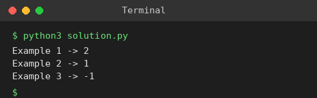

# Exp 68: Network Delay Time

## Aim
To find the minimum time for a signal sent from node k to reach all n nodes (or -1).

## Algorithm
1. Build the directed adjacency list
2. Run Dijkstra's algorithm from node k using a min-heap
3. The answer is the maximum shortest distance
4. If some node is unreachable return -1

## Input
```
times = [[2,1,1],[2,3,1],[3,4,1]], n = 4, k = 2
times = [[1,2,1]], n = 2, k = 1
times = [[1,2,1]], n = 2, k = 2
```

## Program
[`solution.py`](solution.py)

```python
import heapq

def network_delay_time(times, n, k):
    g = [[] for _ in range(n + 1)]
    for u, v, w in times:
        g[u].append((v, w))
    dist = {}
    pq = [(0, k)]
    while pq:
        d, u = heapq.heappop(pq)
        if u in dist:
            continue
        dist[u] = d
        for v, w in g[u]:
            if v not in dist:
                heapq.heappush(pq, (d + w, v))
    return max(dist.values()) if len(dist) == n else -1

print("Example 1 ->", network_delay_time([[2, 1, 1], [2, 3, 1], [3, 4, 1]], 4, 2))
print("Example 2 ->", network_delay_time([[1, 2, 1]], 2, 1))
print("Example 3 ->", network_delay_time([[1, 2, 1]], 2, 2))
```

## Output
```
Example 1 -> 2
Example 2 -> 1
Example 3 -> -1
```

## Screenshot


## Result
The program for **Network Delay Time** was implemented and executed successfully, and the output shown above was obtained for all the given test cases.

## Time and Space Complexity
| | Complexity |
|---|---|
| **Time** | O(E log V) |
| **Space** | O(V + E) |
