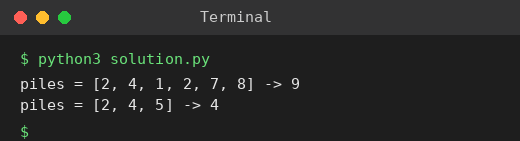

# Exp 69: Maximum Number of Coins You Can Get

## Aim
To find the maximum coins you can collect when, from every chosen triplet of piles, Alice takes the largest, you take the second largest and Bob takes the smallest.

## Algorithm
1. Sort the piles in ascending order
2. Bob always takes the smallest pile, so give him the n/3 smallest piles
3. From the remaining piles pair the two largest together each time: Alice takes the largest, you take the next
4. Sum every second pile starting at index n/3

## Input
```
piles = [2,4,1,2,7,8]
piles = [2,4,5]
```

## Program
[`solution.py`](solution.py)

```python
def max_coins(piles):
    piles = sorted(piles)
    n = len(piles) // 3
    return sum(piles[n::2])

for p in ([2, 4, 1, 2, 7, 8], [2, 4, 5]):
    print(f"piles = {p} -> {max_coins(p)}")
```

## Output
```
piles = [2, 4, 1, 2, 7, 8] -> 9
piles = [2, 4, 5] -> 4
```

## Screenshot


## Result
The program for **Maximum Number of Coins You Can Get** was implemented and executed successfully, and the output shown above was obtained for all the given test cases.

## Time and Space Complexity
| | Complexity |
|---|---|
| **Time** | O(n log n) |
| **Space** | O(1) extra |
