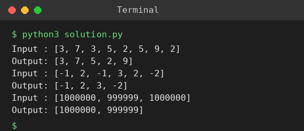

# Exp 7: Unique Elements of a List

## Aim
To create a new list containing only the unique elements of the input list and find the space complexity.

## Algorithm
1. Create an empty set 'seen' and an empty list 'out'
2. Traverse the input list
3. If the element is not in 'seen', add it to 'seen' and append it to 'out'
4. Return 'out'

## Input
```
[3,7,3,5,2,5,9,2]
[-1,2,-1,3,2,-2]
[1000000,999999,1000000]
```

## Program
[`solution.py`](solution.py)

```python
def unique(a):
    seen, out = set(), []
    for x in a:
        if x not in seen:
            seen.add(x)
            out.append(x)
    return out

for a in ([3, 7, 3, 5, 2, 5, 9, 2], [-1, 2, -1, 3, 2, -2], [1000000, 999999, 1000000]):
    print("Input :", a)
    print("Output:", unique(a))
```

## Output
```
Input : [3, 7, 3, 5, 2, 5, 9, 2]
Output: [3, 7, 5, 2, 9]
Input : [-1, 2, -1, 3, 2, -2]
Output: [-1, 2, 3, -2]
Input : [1000000, 999999, 1000000]
Output: [1000000, 999999]
```

## Screenshot


## Result
The program for **Unique Elements of a List** was implemented and executed successfully, and the output shown above was obtained for all the given test cases.

## Time and Space Complexity
| | Complexity |
|---|---|
| **Time** | O(n) |
| **Space** | O(n) - the set and the output list can hold n distinct elements |
