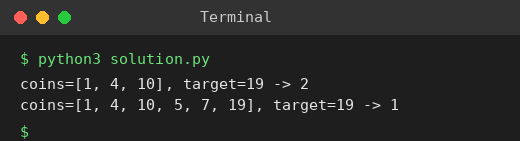

# Exp 70: Patching Array (Minimum Coins to Add)

## Aim
To find the minimum number of coins to add so that every integer in [1, target] can be formed as a subsequence sum.

## Algorithm
1. Sort the coins and keep 'reach' = every value in [1, reach] is obtainable (start at 0)
2. If the next coin <= reach + 1 use it: reach += coin
3. Otherwise add a coin of value reach + 1 (greedy: doubles the reach) and count it
4. Stop when reach >= target

## Input
```
coins = [1,4,10], target = 19
coins = [1,4,10,5,7,19], target = 19
```

## Program
[`solution.py`](solution.py)

```python
def min_added_coins(coins, target):
    coins = sorted(coins)
    reach, i, added = 0, 0, 0
    while reach < target:
        if i < len(coins) and coins[i] <= reach + 1:
            reach += coins[i]
            i += 1
        else:
            reach += reach + 1
            added += 1
    return added

for coins, t in (([1, 4, 10], 19), ([1, 4, 10, 5, 7, 19], 19)):
    print(f"coins={coins}, target={t} -> {min_added_coins(coins, t)}")
```

## Output
```
coins=[1, 4, 10], target=19 -> 2
coins=[1, 4, 10, 5, 7, 19], target=19 -> 1
```

## Screenshot


## Result
The program for **Patching Array (Minimum Coins to Add)** was implemented and executed successfully, and the output shown above was obtained for all the given test cases.

## Time and Space Complexity
| | Complexity |
|---|---|
| **Time** | O(m + log target) |
| **Space** | O(1) extra |
