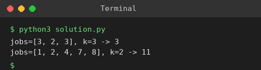

# Exp 71: Minimum Maximum Working Time (Job Assignment)

## Aim
To assign jobs to k workers so that the maximum working time of any worker is minimised.

## Algorithm
1. Sort jobs in descending order (greedy: place big jobs first)
2. Backtrack: try giving the current job to each worker
3. Prune when the current maximum is already >= the best found, and skip workers that currently have identical load
4. Return the best maximum

## Input
```
jobs = [3,2,3], k = 3
jobs = [1,2,4,7,8], k = 2
```

## Program
[`solution.py`](solution.py)

```python
def min_time(jobs, k):
    jobs = sorted(jobs, reverse=True)
    best = [sum(jobs)]
    loads = [0] * k

    def dfs(i, cur_max):
        if cur_max >= best[0]:
            return
        if i == len(jobs):
            best[0] = cur_max
            return
        seen = set()
        for w in range(k):
            if loads[w] in seen:
                continue
            seen.add(loads[w])
            loads[w] += jobs[i]
            dfs(i + 1, max(cur_max, loads[w]))
            loads[w] -= jobs[i]

    dfs(0, 0)
    return best[0]

for jobs, k in (([3, 2, 3], 3), ([1, 2, 4, 7, 8], 2)):
    print(f"jobs={jobs}, k={k} -> {min_time(jobs, k)}")
```

## Output
```
jobs=[3, 2, 3], k=3 -> 3
jobs=[1, 2, 4, 7, 8], k=2 -> 11
```

## Screenshot


## Result
The program for **Minimum Maximum Working Time (Job Assignment)** was implemented and executed successfully, and the output shown above was obtained for all the given test cases.

## Time and Space Complexity
| | Complexity |
|---|---|
| **Time** | O(k^n) worst case, heavy pruning in practice |
| **Space** | O(n + k) |
