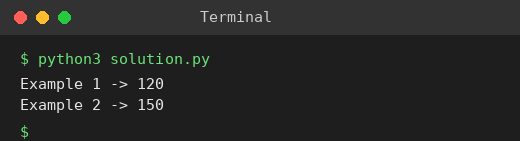

# Exp 72: Maximum Profit in Job Scheduling

## Aim
To find the maximum profit from non-overlapping jobs.

## Algorithm
1. Sort jobs by end time
2. dp[i] = best profit using the first i jobs
3. For job i find (binary search) the last job whose end <= start of job i
4. dp[i] = max(dp[i-1], profit[i] + dp[that job])

## Input
```
startTime=[1,2,3,3], endTime=[3,4,5,6], profit=[50,10,40,70]
startTime=[1,2,3,4,6], endTime=[3,5,10,6,9], profit=[20,20,100,70,60]
```

## Program
[`solution.py`](solution.py)

```python
from bisect import bisect_right

def job_scheduling(start, end, profit):
    jobs = sorted(zip(end, start, profit))
    ends = [j[0] for j in jobs]
    dp = [0] * (len(jobs) + 1)
    for i, (e, s, p) in enumerate(jobs, 1):
        k = bisect_right(ends, s, 0, i - 1)
        dp[i] = max(dp[i - 1], dp[k] + p)
    return dp[-1]

print("Example 1 ->", job_scheduling([1, 2, 3, 3], [3, 4, 5, 6], [50, 10, 40, 70]))
print("Example 2 ->", job_scheduling([1, 2, 3, 4, 6], [3, 5, 10, 6, 9], [20, 20, 100, 70, 60]))
```

## Output
```
Example 1 -> 120
Example 2 -> 150
```

## Screenshot


## Result
The program for **Maximum Profit in Job Scheduling** was implemented and executed successfully, and the output shown above was obtained for all the given test cases.

## Time and Space Complexity
| | Complexity |
|---|---|
| **Time** | O(n log n) |
| **Space** | O(n) |
