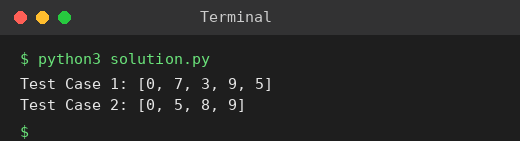

# Exp 73: Dijkstra's Algorithm (Adjacency Matrix)

## Aim
To find the shortest paths from a source vertex to all vertices of a weighted graph given as an adjacency matrix.

## Algorithm
1. Set dist[source] = 0 and all others to infinity
2. Repeatedly pick the unvisited vertex u with the smallest distance
3. Relax every edge (u, v): dist[v] = min(dist[v], dist[u] + w)
4. Mark u visited; stop when all vertices are processed

## Input
```
Test 1: n=5, source=0, a 5x5 matrix with Infinity for missing edges
Test 2: n=4, source=0
```

## Program
[`solution.py`](solution.py)

```python
INF = float("inf")

def dijkstra(graph, src):
    n = len(graph)
    dist, done = [INF] * n, [False] * n
    dist[src] = 0
    for _ in range(n):
        u = min((i for i in range(n) if not done[i]), key=lambda i: dist[i])
        if dist[u] == INF:
            break
        done[u] = True
        for v in range(n):
            if graph[u][v] != INF and dist[u] + graph[u][v] < dist[v]:
                dist[v] = dist[u] + graph[u][v]
    return dist

g1 = [[0, 10, 3, INF, INF], [INF, 0, 1, 2, INF], [INF, 4, 0, 8, 2], [INF, INF, INF, 0, 7], [INF, INF, INF, 9, 0]]
g2 = [[0, 5, INF, 10], [INF, 0, 3, INF], [INF, INF, 0, 1], [INF, INF, INF, 0]]
print("Test Case 1:", dijkstra(g1, 0))
print("Test Case 2:", dijkstra(g2, 0))
```

## Output
```
Test Case 1: [0, 7, 3, 9, 5]
Test Case 2: [0, 5, 8, 9]
```

## Screenshot


## Result
The program for **Dijkstra's Algorithm (Adjacency Matrix)** was implemented and executed successfully, and the output shown above was obtained for all the given test cases.

## Time and Space Complexity
| | Complexity |
|---|---|
| **Time** | O(V^2) |
| **Space** | O(V) |
