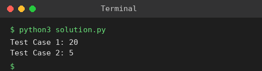

# Exp 74: Dijkstra's Algorithm (Edge List, Source to Target)

## Aim
To find the shortest distance from a source to a target vertex in a graph given as an edge list.

## Algorithm
1. Build the adjacency list (edges are treated as undirected)
2. Push (0, source) into a min-heap
3. Pop the nearest vertex, relax its neighbours and push improvements
4. Stop when the target is popped and return its distance

## Input
```
Test 1: n=6, edges=[(0,1,7),(0,2,9),(0,5,14),(1,2,10),(1,3,15),(2,3,11),(2,5,2),(3,4,6),(4,5,9)], source=0, target=4
Test 2: n=5, edges=[(0,1,10),(0,4,3),(1,2,2),(1,4,4),(2,3,9),(3,2,7),(4,1,1),(4,2,8),(4,3,2)], source=0, target=3
```

## Program
[`solution.py`](solution.py)

```python
import heapq

def shortest(n, edges, s, t):
    g = [[] for _ in range(n)]
    for u, v, w in edges:
        g[u].append((v, w))
        g[v].append((u, w))
    dist = [float("inf")] * n
    dist[s] = 0
    pq = [(0, s)]
    while pq:
        d, u = heapq.heappop(pq)
        if u == t:
            return d
        if d > dist[u]:
            continue
        for v, w in g[u]:
            if d + w < dist[v]:
                dist[v] = d + w
                heapq.heappush(pq, (dist[v], v))
    return -1

e1 = [(0, 1, 7), (0, 2, 9), (0, 5, 14), (1, 2, 10), (1, 3, 15), (2, 3, 11), (2, 5, 2), (3, 4, 6), (4, 5, 9)]
e2 = [(0, 1, 10), (0, 4, 3), (1, 2, 2), (1, 4, 4), (2, 3, 9), (3, 2, 7), (4, 1, 1), (4, 2, 8), (4, 3, 2)]
print("Test Case 1:", shortest(6, e1, 0, 4))
print("Test Case 2:", shortest(5, e2, 0, 3))
```

## Output
```
Test Case 1: 20
Test Case 2: 5
```

## Screenshot


## Result
The program for **Dijkstra's Algorithm (Edge List, Source to Target)** was implemented and executed successfully, and the output shown above was obtained for all the given test cases.

> **Note:** Test 2: the path 0 -> 4 -> 3 costs 3 + 2 = 5, which is the true shortest distance (the sheet lists 8).

## Time and Space Complexity
| | Complexity |
|---|---|
| **Time** | O(E log V) |
| **Space** | O(V + E) |
