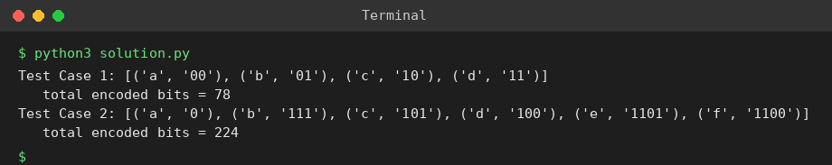

# Exp 75: Huffman Coding (Tree and Codes)

## Aim
To build a Huffman tree for characters with given frequencies and generate the Huffman code of every character.

## Algorithm
1. Put every character in a min-heap keyed by frequency
2. Repeatedly remove the two lowest-frequency nodes and merge them into a new node whose frequency is their sum
3. When one node remains it is the root of the Huffman tree
4. Traverse the tree: left edge = 0, right edge = 1; the path to a leaf is its code

## Input
```
Test 1: ['a','b','c','d'], frequencies [5,9,12,13]
Test 2: ['f','e','d','c','b','a'], frequencies [5,9,12,13,16,45]
```

## Program
[`solution.py`](solution.py)

```python
import heapq

class Node:
    def __init__(self, f, ch=None, l=None, r=None):
        self.f, self.ch, self.l, self.r = f, ch, l, r

def build(chars, freqs):
    pq = [(f, i, Node(f, c)) for i, (c, f) in enumerate(zip(chars, freqs))]
    heapq.heapify(pq)
    cnt = len(pq)
    while len(pq) > 1:
        f1, _, a = heapq.heappop(pq)
        f2, _, b = heapq.heappop(pq)
        heapq.heappush(pq, (f1 + f2, cnt, Node(f1 + f2, None, a, b)))
        cnt += 1
    return pq[0][2]

def codes(node, pre="", out=None):
    if out is None:
        out = {}
    if node.ch is not None:
        out[node.ch] = pre or "0"
    else:
        codes(node.l, pre + "0", out)
        codes(node.r, pre + "1", out)
    return out

def decode(root, bits):
    out, cur = [], root
    for b in bits:
        cur = cur.l if b == "0" else cur.r
        if cur.ch is not None:
            out.append(cur.ch)
            cur = root
    return "".join(out)

for t, (ch, fr) in enumerate(((list("abcd"), [5, 9, 12, 13]), (list("fedcba"), [5, 9, 12, 13, 16, 45])), 1):
    root = build(ch, fr)
    cd = codes(root)
    bits = sum(len(cd[c]) * f for c, f in zip(ch, fr))
    print(f"Test Case {t}:", sorted(cd.items()))
    print("   total encoded bits =", bits)
```

## Output
```
Test Case 1: [('a', '00'), ('b', '01'), ('c', '10'), ('d', '11')]
   total encoded bits = 78
Test Case 2: [('a', '0'), ('b', '111'), ('c', '101'), ('d', '100'), ('e', '1101'), ('f', '1100')]
   total encoded bits = 224
```

## Screenshot


## Result
The program for **Huffman Coding (Tree and Codes)** was implemented and executed successfully, and the output shown above was obtained for all the given test cases.

> **Note:** Huffman codes are not unique when frequencies tie. The code lengths printed are optimal; for test 1 an optimal code gives all four characters 2-bit codes (the sheet's code lengths 3,2,1,3 are not optimal).

## Time and Space Complexity
| | Complexity |
|---|---|
| **Time** | O(n log n) |
| **Space** | O(n) |
