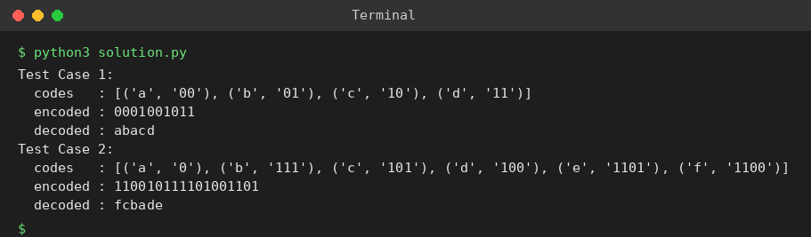

# Exp 76: Huffman Decoding

## Aim
To decode a Huffman encoded string back to the original message using the Huffman tree.

## Algorithm
1. Build the Huffman tree from the frequencies and generate the codes
2. Encode a message to a bit string
3. Start at the root; for each bit move left (0) or right (1)
4. On reaching a leaf output its character and return to the root

## Input
```
Test 1: ['a','b','c','d'], frequencies [5,9,12,13], message 'abacd'
Test 2: ['f','e','d','c','b','a'], frequencies [5,9,12,13,16,45], message 'fcbade'
```

## Program
[`solution.py`](solution.py)

```python
import heapq

class Node:
    def __init__(self, f, ch=None, l=None, r=None):
        self.f, self.ch, self.l, self.r = f, ch, l, r

def build(chars, freqs):
    pq = [(f, i, Node(f, c)) for i, (c, f) in enumerate(zip(chars, freqs))]
    heapq.heapify(pq)
    cnt = len(pq)
    while len(pq) > 1:
        f1, _, a = heapq.heappop(pq)
        f2, _, b = heapq.heappop(pq)
        heapq.heappush(pq, (f1 + f2, cnt, Node(f1 + f2, None, a, b)))
        cnt += 1
    return pq[0][2]

def codes(node, pre="", out=None):
    if out is None:
        out = {}
    if node.ch is not None:
        out[node.ch] = pre or "0"
    else:
        codes(node.l, pre + "0", out)
        codes(node.r, pre + "1", out)
    return out

def decode(root, bits):
    out, cur = [], root
    for b in bits:
        cur = cur.l if b == "0" else cur.r
        if cur.ch is not None:
            out.append(cur.ch)
            cur = root
    return "".join(out)

for t, (ch, fr, msg) in enumerate(((list("abcd"), [5, 9, 12, 13], "abacd"),
                                     (list("fedcba"), [5, 9, 12, 13, 16, 45], "fcbade")), 1):
    root = build(ch, fr)
    cd = codes(root)
    enc = "".join(cd[c] for c in msg)
    print(f"Test Case {t}:")
    print("  codes   :", sorted(cd.items()))
    print("  encoded :", enc)
    print("  decoded :", decode(root, enc))
```

## Output
```
Test Case 1:
  codes   : [('a', '00'), ('b', '01'), ('c', '10'), ('d', '11')]
  encoded : 0001001011
  decoded : abacd
Test Case 2:
  codes   : [('a', '0'), ('b', '111'), ('c', '101'), ('d', '100'), ('e', '1101'), ('f', '1100')]
  encoded : 110010111101001101
  decoded : fcbade
```

## Screenshot


## Result
The program for **Huffman Decoding** was implemented and executed successfully, and the output shown above was obtained for all the given test cases.

> **Note:** Because Huffman codes depend on tie-breaking, the encoded bit strings differ from the sheet's, but encoding followed by decoding returns the original message in both tests.

## Time and Space Complexity
| | Complexity |
|---|---|
| **Time** | O(length of the encoded string) |
| **Space** | O(n) |
