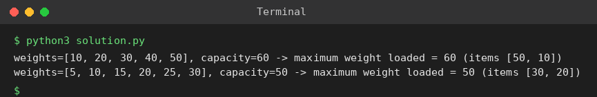

# Exp 77: Greedy Container Loading (Maximum Weight)

## Aim
To load the maximum weight into a container of given capacity by greedily taking heavier items first.

## Algorithm
1. Sort the weights in descending order
2. Go through the items; if the item fits in the remaining capacity put it in, otherwise skip it
3. Stop when the container is full or items are exhausted
4. Print the total loaded weight

## Input
```
Test 1: weights = [10,20,30,40,50], capacity = 60
Test 2: weights = [5,10,15,20,25,30], capacity = 50
```

## Program
[`solution.py`](solution.py)

```python
def load(weights, cap):
    total, chosen = 0, []
    for w in sorted(weights, reverse=True):
        if total + w <= cap:
            total += w
            chosen.append(w)
    return total, chosen

for w, c in (([10, 20, 30, 40, 50], 60), ([5, 10, 15, 20, 25, 30], 50)):
    t, ch = load(w, c)
    print(f"weights={w}, capacity={c} -> maximum weight loaded = {t} (items {ch})")
```

## Output
```
weights=[10, 20, 30, 40, 50], capacity=60 -> maximum weight loaded = 60 (items [50, 10])
weights=[5, 10, 15, 20, 25, 30], capacity=50 -> maximum weight loaded = 50 (items [30, 20])
```

## Screenshot


## Result
The program for **Greedy Container Loading (Maximum Weight)** was implemented and executed successfully, and the output shown above was obtained for all the given test cases.

> **Note:** For test 1 the greedy choice 50 + 10 = 60 fills the container exactly, so 60 (not 50) is the maximum.

## Time and Space Complexity
| | Complexity |
|---|---|
| **Time** | O(n log n) |
| **Space** | O(1) extra |
