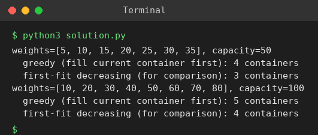

# Exp 78: Greedy Container Loading (Minimum Containers)

## Aim
To find the minimum number of containers needed by filling the current container before opening the next one.

## Algorithm
1. Open the first container with zero load
2. For each item, if it fits in the current container add it, otherwise open a new container
3. Count the containers
4. Also compare with First-Fit Decreasing

## Input
```
Test 1: weights = [5,10,15,20,25,30,35], capacity = 50
Test 2: weights = [10,20,30,40,50,60,70,80], capacity = 100
```

## Program
[`solution.py`](solution.py)

```python
def next_fit(weights, cap):
    bins, cur = 1, 0
    for w in weights:
        if cur + w > cap:
            bins += 1
            cur = 0
        cur += w
    return bins

def first_fit_decreasing(weights, cap):
    bins = []
    for w in sorted(weights, reverse=True):
        for i in range(len(bins)):
            if bins[i] + w <= cap:
                bins[i] += w
                break
        else:
            bins.append(w)
    return len(bins)

for w, c in (([5, 10, 15, 20, 25, 30, 35], 50), ([10, 20, 30, 40, 50, 60, 70, 80], 100)):
    print(f"weights={w}, capacity={c}")
    print(f"  greedy (fill current container first): {next_fit(w, c)} containers")
    print(f"  first-fit decreasing (for comparison): {first_fit_decreasing(w, c)} containers")
```

## Output
```
weights=[5, 10, 15, 20, 25, 30, 35], capacity=50
  greedy (fill current container first): 4 containers
  first-fit decreasing (for comparison): 3 containers
weights=[10, 20, 30, 40, 50, 60, 70, 80], capacity=100
  greedy (fill current container first): 5 containers
  first-fit decreasing (for comparison): 4 containers
```

## Screenshot


## Result
The program for **Greedy Container Loading (Minimum Containers)** was implemented and executed successfully, and the output shown above was obtained for all the given test cases.

> **Note:** Test 1 gives 4 as expected. For test 2 the greedy scan uses 5 containers (the sheet lists 6); first-fit decreasing needs only 4.

## Time and Space Complexity
| | Complexity |
|---|---|
| **Time** | O(n) for the greedy scan (O(n log n) for first-fit decreasing) |
| **Space** | O(n) |
