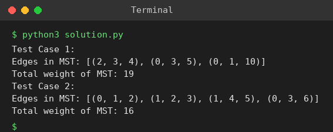

# Exp 79: Kruskal's Minimum Spanning Tree

## Aim
To find the minimum spanning tree of a weighted graph and its total weight using Kruskal's algorithm.

## Algorithm
1. Sort all edges by weight
2. Initialise a disjoint-set (union-find) with every vertex alone
3. Take edges in order; if the end points are in different sets, add the edge to the MST and union the sets
4. Stop after n-1 edges and print the MST and its weight

## Input
```
Test 1: n=4, edges=[(0,1,10),(0,2,6),(0,3,5),(1,3,15),(2,3,4)]
Test 2: n=5, edges=[(0,1,2),(0,3,6),(1,2,3),(1,3,8),(1,4,5),(2,4,7),(3,4,9)]
```

## Program
[`solution.py`](solution.py)

```python
class DSU:
    def __init__(self, n):
        self.p = list(range(n))
    def find(self, x):
        while self.p[x] != x:
            self.p[x] = self.p[self.p[x]]
            x = self.p[x]
        return x
    def union(self, a, b):
        a, b = self.find(a), self.find(b)
        if a == b:
            return False
        self.p[a] = b
        return True

def kruskal(n, edges):
    dsu, mst, total = DSU(n), [], 0
    for u, v, w in sorted(edges, key=lambda e: e[2]):
        if dsu.union(u, v):
            mst.append((u, v, w))
            total += w
    return mst, total

tests = [(4, [(0, 1, 10), (0, 2, 6), (0, 3, 5), (1, 3, 15), (2, 3, 4)]),
         (5, [(0, 1, 2), (0, 3, 6), (1, 2, 3), (1, 3, 8), (1, 4, 5), (2, 4, 7), (3, 4, 9)])]
for t, (n, E) in enumerate(tests, 1):
    mst, total = kruskal(n, E)
    print(f"Test Case {t}:")
    print("Edges in MST:", mst)
    print("Total weight of MST:", total)
```

## Output
```
Test Case 1:
Edges in MST: [(2, 3, 4), (0, 3, 5), (0, 1, 10)]
Total weight of MST: 19
Test Case 2:
Edges in MST: [(0, 1, 2), (1, 2, 3), (1, 4, 5), (0, 3, 6)]
Total weight of MST: 16
```

## Screenshot


## Result
The program for **Kruskal's Minimum Spanning Tree** was implemented and executed successfully, and the output shown above was obtained for all the given test cases.

## Time and Space Complexity
| | Complexity |
|---|---|
| **Time** | O(E log E) |
| **Space** | O(V) |
