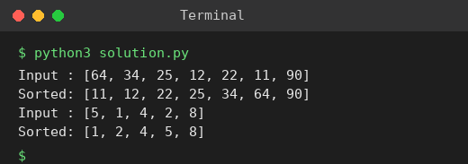

# Exp 8: Bubble Sort

## Aim
To sort an array of integers using bubble sort and analyse its time complexity using Big-O notation.

## Algorithm
1. Repeat n-1 passes over the array
2. In each pass compare adjacent elements and swap them if they are in the wrong order
3. After each pass the largest remaining element reaches its final place
4. Stop after the last pass

## Input
```
[64,34,25,12,22,11,90]
[5,1,4,2,8]
```

## Program
[`solution.py`](solution.py)

```python
def bubble_sort(a):
    a = a[:]
    n = len(a)
    for i in range(n - 1):
        for j in range(n - 1 - i):
            if a[j] > a[j + 1]:
                a[j], a[j + 1] = a[j + 1], a[j]
    return a

for a in ([64, 34, 25, 12, 22, 11, 90], [5, 1, 4, 2, 8]):
    print("Input :", a)
    print("Sorted:", bubble_sort(a))
```

## Output
```
Input : [64, 34, 25, 12, 22, 11, 90]
Sorted: [11, 12, 22, 25, 34, 64, 90]
Input : [5, 1, 4, 2, 8]
Sorted: [1, 2, 4, 5, 8]
```

## Screenshot


## Result
The program for **Bubble Sort** was implemented and executed successfully, and the output shown above was obtained for all the given test cases.

## Time and Space Complexity
| | Complexity |
|---|---|
| **Time** | O(n^2) worst and average case, O(n^2) comparisons even when sorted (basic version) |
| **Space** | O(1) |
