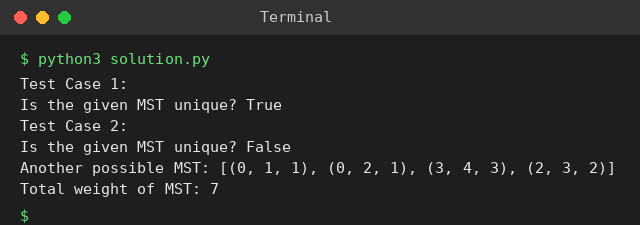

# Exp 80: Uniqueness of a Minimum Spanning Tree

## Aim
To verify whether a given MST is unique and, if it is not, to give another MST.

## Algorithm
1. Compute the MST weight with Kruskal and check the given tree is a spanning tree of the same weight
2. For every non-tree edge (u, v, w) find the path from u to v in the given tree
3. If the heaviest edge on that path has weight equal to w, swapping it for (u, v, w) gives another MST, so the MST is not unique
4. If no such edge exists the MST is unique

## Input
```
Test 1: n=4, edges=[(0,1,10),(0,2,6),(0,3,5),(1,3,15),(2,3,4)], given_mst=[(2,3,4),(0,3,5),(0,1,10)]
Test 2: n=5, edges=[(0,1,1),(0,2,1),(1,3,2),(2,3,2),(3,4,3),(4,2,3)], given_mst=[(0,1,1),(0,2,1),(1,3,2),(3,4,3)]
```

## Program
[`solution.py`](solution.py)

```python
class DSU:
    def __init__(self, n):
        self.p = list(range(n))
    def find(self, x):
        while self.p[x] != x:
            self.p[x] = self.p[self.p[x]]
            x = self.p[x]
        return x
    def union(self, a, b):
        a, b = self.find(a), self.find(b)
        if a == b:
            return False
        self.p[a] = b
        return True

def kruskal(n, edges):
    dsu, mst, total = DSU(n), [], 0
    for u, v, w in sorted(edges, key=lambda e: e[2]):
        if dsu.union(u, v):
            mst.append((u, v, w))
            total += w
    return mst, total

def tree_path(n, tree, s, t):
    g = [[] for _ in range(n)]
    for e in tree:
        g[e[0]].append((e[1], e))
        g[e[1]].append((e[0], e))
    stack, seen = [(s, [])], {s}
    while stack:
        u, path = stack.pop()
        if u == t:
            return path
        for v, e in g[u]:
            if v not in seen:
                seen.add(v)
                stack.append((v, path + [e]))

def check_unique(n, edges, mst):
    _, best = kruskal(n, edges)
    assert sum(e[2] for e in mst) == best, "given tree is not an MST"
    for e in edges:
        if e in mst:
            continue
        u, v, w = e
        heavy = max(tree_path(n, mst, u, v), key=lambda x: x[2])
        if heavy[2] == w:
            return False, [x for x in mst if x != heavy] + [e], best
    return True, None, best

tests = [(4, [(0, 1, 10), (0, 2, 6), (0, 3, 5), (1, 3, 15), (2, 3, 4)], [(2, 3, 4), (0, 3, 5), (0, 1, 10)]),
         (5, [(0, 1, 1), (0, 2, 1), (1, 3, 2), (2, 3, 2), (3, 4, 3), (4, 2, 3)], [(0, 1, 1), (0, 2, 1), (1, 3, 2), (3, 4, 3)])]
for t, (n, E, mst) in enumerate(tests, 1):
    uniq, alt, w = check_unique(n, E, mst)
    print(f"Test Case {t}:")
    print("Is the given MST unique?", uniq)
    if not uniq:
        print("Another possible MST:", alt)
        print("Total weight of MST:", w)
```

## Output
```
Test Case 1:
Is the given MST unique? True
Test Case 2:
Is the given MST unique? False
Another possible MST: [(0, 1, 1), (0, 2, 1), (3, 4, 3), (2, 3, 2)]
Total weight of MST: 7
```

## Screenshot


## Result
The program for **Uniqueness of a Minimum Spanning Tree** was implemented and executed successfully, and the output shown above was obtained for all the given test cases.

## Time and Space Complexity
| | Complexity |
|---|---|
| **Time** | O(E * V) |
| **Space** | O(V + E) |
