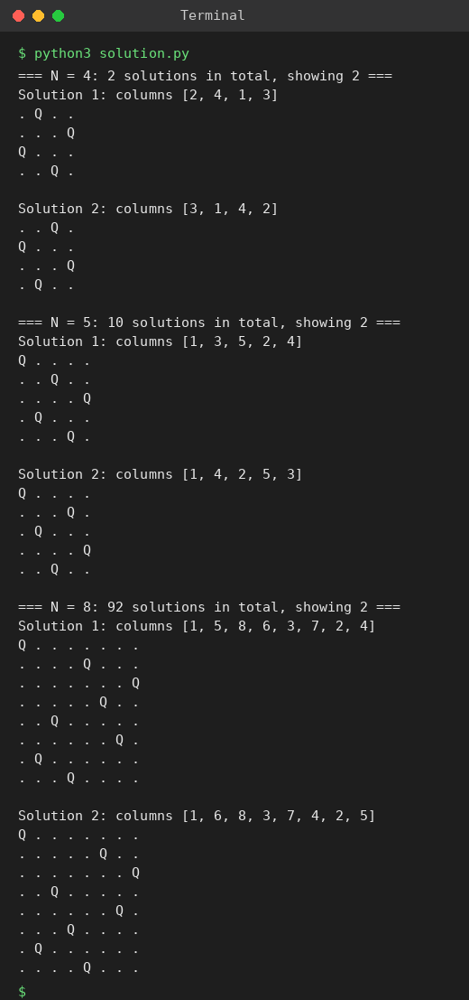

# Exp 81: N-Queens Visualisation

## Aim
To solve the N-Queens problem with backtracking and display the placement of the queens on the board for N = 4, 5 and 8.

## Algorithm
1. Place one queen per row, trying every column
2. A square is safe if no queen is in the same column or on the same diagonal (row-col and row+col sets)
3. If safe place the queen and recurse to the next row; otherwise skip
4. If the recursion fails remove the queen (backtrack)
5. Draw each solution: Q = queen, . = empty square

## Input
```
N = 4
N = 5
N = 8
```

## Program
[`solution.py`](solution.py)

```python
def solve(n):
    sols, cols, d1, d2, place = [], set(), set(), set(), []
    def bt(r):
        if r == n:
            sols.append(place[:])
            return
        for c in range(n):
            if c in cols or r - c in d1 or r + c in d2:
                continue
            cols.add(c); d1.add(r - c); d2.add(r + c); place.append(c)
            bt(r + 1)
            cols.remove(c); d1.remove(r - c); d2.remove(r + c); place.pop()
    bt(0)
    return sols

def draw(sol):
    for c in sol:
        print(" ".join("Q" if j == c else "." for j in range(len(sol))))

for n, how_many in ((4, 2), (5, 2), (8, 2)):
    sols = solve(n)
    print(f"=== N = {n}: {len(sols)} solutions in total, showing {how_many} ===")
    for k in range(how_many):
        print(f"Solution {k + 1}: columns {[c + 1 for c in sols[k]]}")
        draw(sols[k])
        print()
```

## Output
```
=== N = 4: 2 solutions in total, showing 2 ===
Solution 1: columns [2, 4, 1, 3]
. Q . .
. . . Q
Q . . .
. . Q .

Solution 2: columns [3, 1, 4, 2]
. . Q .
Q . . .
. . . Q
. Q . .

=== N = 5: 10 solutions in total, showing 2 ===
Solution 1: columns [1, 3, 5, 2, 4]
Q . . . .
. . Q . .
. . . . Q
. Q . . .
. . . Q .

Solution 2: columns [1, 4, 2, 5, 3]
Q . . . .
. . . Q .
. Q . . .
. . . . Q
. . Q . .

=== N = 8: 92 solutions in total, showing 2 ===
Solution 1: columns [1, 5, 8, 6, 3, 7, 2, 4]
Q . . . . . . .
. . . . Q . . .
. . . . . . . Q
. . . . . Q . .
. . Q . . . . .
. . . . . . Q .
. Q . . . . . .
. . . Q . . . .

Solution 2: columns [1, 6, 8, 3, 7, 4, 2, 5]
Q . . . . . . .
. . . . . Q . .
. . . . . . . Q
. . Q . . . . .
. . . . . . Q .
. . . Q . . . .
. Q . . . . . .
. . . . Q . . .
```

## Screenshot


## Result
The program for **N-Queens Visualisation** was implemented and executed successfully, and the output shown above was obtained for all the given test cases.

> **Note:** Visualising the board makes it easy to see conflicts: a drawn solution can be checked row by row, column by column and along diagonals, which helps to debug the safety test and shows how the number of solutions grows (2, 10, 92 for N = 4, 5, 8).

## Time and Space Complexity
| | Complexity |
|---|---|
| **Time** | O(N!) |
| **Space** | O(N) |
