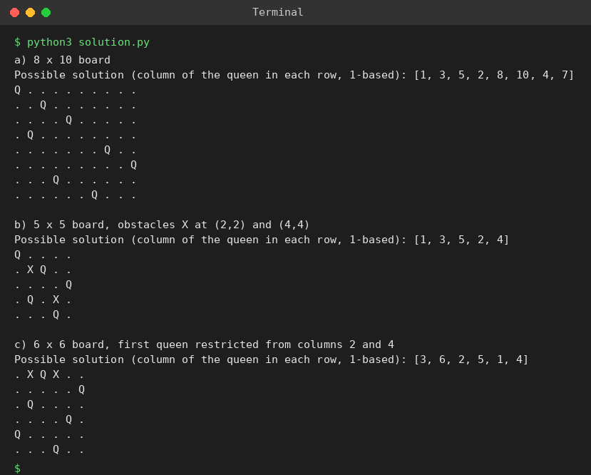

# Exp 82: Generalised N-Queens (Rectangular Boards, Obstacles, Restrictions)

## Aim
To adapt the N-Queens backtracking algorithm to a rectangular board, a board with obstacles and a board with restricted positions.

## Algorithm
1. Place one queen per row (rows = number of queens), trying every allowed column
2. Skip squares that are blocked (obstacles or restricted positions)
3. Check column and diagonal attacks against queens already placed
4. Backtrack when no column works; print the first valid placement

## Input
```
8 x 10 board (8 queens)
5 x 5 board with obstacles at (2,2) and (4,4)
6 x 6 board, first queen may not use columns 2 and 4
```

## Program
[`solution.py`](solution.py)

```python
def solve(R, C, blocked=lambda r, c: False):
    place = []
    def bt(r):
        if r == R:
            return True
        for c in range(C):
            if blocked(r, c):
                continue
            if any(c == pc or abs(r - pr) == abs(c - pc) for pr, pc in enumerate(place)):
                continue
            place.append(c)
            if bt(r + 1):
                return True
            place.pop()
        return False
    return place[:] if bt(0) else None

def draw(sol, R, C, blocked=lambda r, c: False):
    for r in range(R):
        print(" ".join("Q" if sol[r] == c else ("X" if blocked(r, c) else ".") for c in range(C)))

def run(title, R, C, blocked=lambda r, c: False):
    sol = solve(R, C, blocked)
    print(title)
    if sol is None:
        print("No solution")
    else:
        print("Possible solution (column of the queen in each row, 1-based):", [c + 1 for c in sol])
        draw(sol, R, C, blocked)
    print()

run("a) 8 x 10 board", 8, 10)
obst = {(2, 2), (4, 4)}                                  # 1-based obstacle squares
run("b) 5 x 5 board, obstacles X at (2,2) and (4,4)", 5, 5, lambda r, c: (r + 1, c + 1) in obst)
run("c) 6 x 6 board, first queen restricted from columns 2 and 4", 6, 6, lambda r, c: r == 0 and c + 1 in (2, 4))
```

## Output
```
a) 8 x 10 board
Possible solution (column of the queen in each row, 1-based): [1, 3, 5, 2, 8, 10, 4, 7]
Q . . . . . . . . .
. . Q . . . . . . .
. . . . Q . . . . .
. Q . . . . . . . .
. . . . . . . Q . .
. . . . . . . . . Q
. . . Q . . . . . .
. . . . . . Q . . .

b) 5 x 5 board, obstacles X at (2,2) and (4,4)
Possible solution (column of the queen in each row, 1-based): [1, 3, 5, 2, 4]
Q . . . .
. X Q . .
. . . . Q
. Q . X .
. . . Q .

c) 6 x 6 board, first queen restricted from columns 2 and 4
Possible solution (column of the queen in each row, 1-based): [3, 6, 2, 5, 1, 4]
. X Q X . .
. . . . . Q
. Q . . . .
. . . . Q .
Q . . . . .
. . . Q . .
```

## Screenshot


## Result
The program for **Generalised N-Queens (Rectangular Boards, Obstacles, Restrictions)** was implemented and executed successfully, and the output shown above was obtained for all the given test cases.

> **Note:** Assumptions: obstacles are squares that cannot hold a queen; 'restricted positions' means the first queen may not be placed in columns 2 or 4. The sheet's sample solutions contain attacking queens, so valid placements found by the program are shown instead.

## Time and Space Complexity
| | Complexity |
|---|---|
| **Time** | O(C^R) worst case (heavily pruned) |
| **Space** | O(R) |
