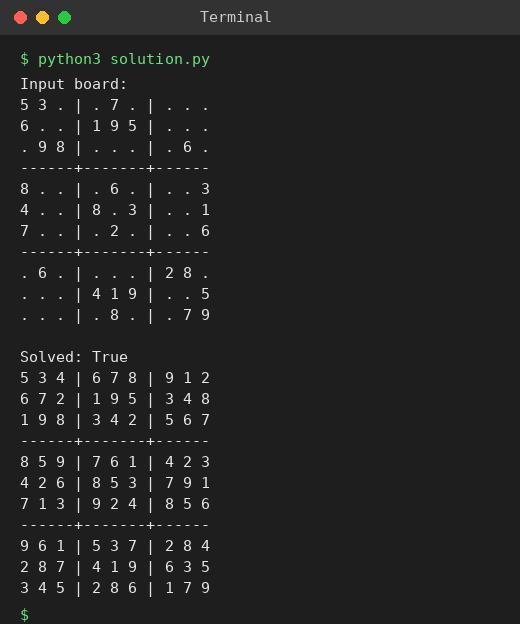

# Exp 84: Sudoku Solver (Constraint Check with Row, Column and Box Sets)

## Aim
To solve a Sudoku puzzle so that every row, column and 3x3 sub-box contains the digits 1-9 exactly once.

## Algorithm
1. Record the digits already present in every row, column and 3x3 box and list the empty cells
2. Take the next empty cell and try digits 1 to 9
3. A digit is allowed if it is not already in the cell's row, column or box; place it and recurse
4. If no digit fits, undo the last placement (backtrack)
5. When all empty cells are filled the puzzle is solved

## Input
```
9 x 9 board with '.' for empty cells (standard example puzzle)
```

## Program
[`solution.py`](solution.py)

```python
def solve_sudoku(board):
    rows = [set() for _ in range(9)]
    cols = [set() for _ in range(9)]
    boxes = [set() for _ in range(9)]
    empties = []
    for r in range(9):
        for c in range(9):
            v = board[r][c]
            if v == ".":
                empties.append((r, c))
            else:
                rows[r].add(v); cols[c].add(v); boxes[r // 3 * 3 + c // 3].add(v)

    def bt(k):
        if k == len(empties):
            return True
        r, c = empties[k]
        b = r // 3 * 3 + c // 3
        for v in "123456789":
            if v in rows[r] or v in cols[c] or v in boxes[b]:
                continue
            board[r][c] = v
            rows[r].add(v); cols[c].add(v); boxes[b].add(v)
            if bt(k + 1):
                return True
            board[r][c] = "."
            rows[r].discard(v); cols[c].discard(v); boxes[b].discard(v)
        return False

    return bt(0)

board = [["5","3",".",".","7",".",".",".","."],["6",".",".","1","9","5",".",".","."],
         [".","9","8",".",".",".",".","6","."],["8",".",".",".","6",".",".",".","3"],
         ["4",".",".","8",".","3",".",".","1"],["7",".",".",".","2",".",".",".","6"],
         [".","6",".",".",".",".","2","8","."],[".",".",".","4","1","9",".",".","5"],
         [".",".",".",".","8",".",".","7","9"]]

def show(b):
    for i, row in enumerate(b):
        if i % 3 == 0 and i:
            print("------+-------+------")
        print(" ".join(" ".join(row[j:j + 3]) + (" |" if j < 6 else "") for j in range(0, 9, 3)))

print("Input board:")
show(board)
print("\nSolved:", solve_sudoku(board))
show(board)
```

## Output
```
Input board:
5 3 . | . 7 . | . . .
6 . . | 1 9 5 | . . .
. 9 8 | . . . | . 6 .
------+-------+------
8 . . | . 6 . | . . 3
4 . . | 8 . 3 | . . 1
7 . . | . 2 . | . . 6
------+-------+------
. 6 . | . . . | 2 8 .
. . . | 4 1 9 | . . 5
. . . | . 8 . | . 7 9

Solved: True
5 3 4 | 6 7 8 | 9 1 2
6 7 2 | 1 9 5 | 3 4 8
1 9 8 | 3 4 2 | 5 6 7
------+-------+------
8 5 9 | 7 6 1 | 4 2 3
4 2 6 | 8 5 3 | 7 9 1
7 1 3 | 9 2 4 | 8 5 6
------+-------+------
9 6 1 | 5 3 7 | 2 8 4
2 8 7 | 4 1 9 | 6 3 5
3 4 5 | 2 8 6 | 1 7 9
```

## Screenshot


## Result
The program for **Sudoku Solver (Constraint Check with Row, Column and Box Sets)** was implemented and executed successfully, and the output shown above was obtained for all the given test cases.

## Time and Space Complexity
| | Complexity |
|---|---|
| **Time** | O(9^m) |
| **Space** | O(m) |
