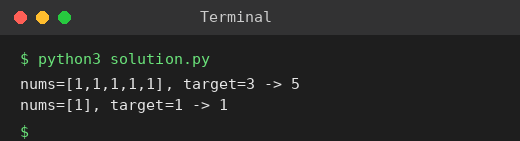

# Exp 85: Target Sum (Assign + or -)

## Aim
To count the ways to put + or - before each number so that the expression evaluates to the target.

## Algorithm
1. Recursively decide + or - for each element, keeping the running sum
2. When all numbers are used count 1 if the sum equals the target
3. Memoise on (index, sum) to avoid repeated work
4. Return the total count

## Input
```
nums = [1,1,1,1,1], target = 3
nums = [1], target = 1
```

## Program
[`solution.py`](solution.py)

```python
from functools import lru_cache

def find_target_sum_ways(nums, target):
    @lru_cache(None)
    def go(i, s):
        if i == len(nums):
            return 1 if s == target else 0
        return go(i + 1, s + nums[i]) + go(i + 1, s - nums[i])
    return go(0, 0)

print("nums=[1,1,1,1,1], target=3 ->", find_target_sum_ways((1, 1, 1, 1, 1), 3))
print("nums=[1], target=1 ->", find_target_sum_ways((1,), 1))
```

## Output
```
nums=[1,1,1,1,1], target=3 -> 5
nums=[1], target=1 -> 1
```

## Screenshot


## Result
The program for **Target Sum (Assign + or -)** was implemented and executed successfully, and the output shown above was obtained for all the given test cases.

## Time and Space Complexity
| | Complexity |
|---|---|
| **Time** | O(n * S), S = sum of the numbers (with memoisation) |
| **Space** | O(n * S) |
