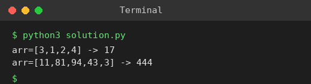

# Exp 86: Sum of Subarray Minimums

## Aim
To find the sum of the minimum of every contiguous subarray, modulo 10^9 + 7.

## Algorithm
1. For every element find how far it is the minimum to the left (previous smaller) and to the right (next smaller or equal) with a monotonic stack
2. It is the minimum of left * right subarrays
3. Add arr[i] * left * right for every element
4. Take the result modulo 10^9 + 7

## Input
```
arr = [3,1,2,4]
arr = [11,81,94,43,3]
```

## Program
[`solution.py`](solution.py)

```python
def sum_subarray_mins(arr):
    MOD = 10 ** 9 + 7
    n = len(arr)
    left, right, st = [0] * n, [0] * n, []
    for i in range(n):
        while st and arr[st[-1]] > arr[i]:
            st.pop()
        left[i] = i - (st[-1] if st else -1)
        st.append(i)
    st = []
    for i in range(n - 1, -1, -1):
        while st and arr[st[-1]] >= arr[i]:
            st.pop()
        right[i] = (st[-1] if st else n) - i
        st.append(i)
    return sum(a * l * r for a, l, r in zip(arr, left, right)) % MOD

print("arr=[3,1,2,4] ->", sum_subarray_mins([3, 1, 2, 4]))
print("arr=[11,81,94,43,3] ->", sum_subarray_mins([11, 81, 94, 43, 3]))
```

## Output
```
arr=[3,1,2,4] -> 17
arr=[11,81,94,43,3] -> 444
```

## Screenshot


## Result
The program for **Sum of Subarray Minimums** was implemented and executed successfully, and the output shown above was obtained for all the given test cases.

## Time and Space Complexity
| | Complexity |
|---|---|
| **Time** | O(n) |
| **Space** | O(n) |
