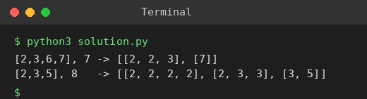

# Exp 87: Combination Sum

## Aim
To list all unique combinations of candidates that sum to the target when each number may be used any number of times.

## Algorithm
1. Backtrack over the candidate index, keeping the current combination and remaining target
2. If remaining == 0 record the combination
3. For each candidate from the current index choose it (it may be chosen again) and recurse
4. Stop a branch when the remaining target becomes negative

## Input
```
candidates = [2,3,6,7], target = 7
candidates = [2,3,5], target = 8
```

## Program
[`solution.py`](solution.py)

```python
def combination_sum(cands, target):
    res = []
    def bt(start, cur, rem):
        if rem == 0:
            res.append(cur[:])
            return
        for i in range(start, len(cands)):
            if cands[i] > rem:
                continue
            cur.append(cands[i])
            bt(i, cur, rem - cands[i])
            cur.pop()
    bt(0, [], target)
    return res

print("[2,3,6,7], 7 ->", combination_sum([2, 3, 6, 7], 7))
print("[2,3,5], 8   ->", combination_sum([2, 3, 5], 8))
```

## Output
```
[2,3,6,7], 7 -> [[2, 2, 3], [7]]
[2,3,5], 8   -> [[2, 2, 2, 2], [2, 3, 3], [3, 5]]
```

## Screenshot


## Result
The program for **Combination Sum** was implemented and executed successfully, and the output shown above was obtained for all the given test cases.

## Time and Space Complexity
| | Complexity |
|---|---|
| **Time** | O(2^t) roughly, t = target / smallest candidate |
| **Space** | O(t) recursion |
