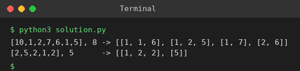

# Exp 88: Combination Sum II

## Aim
To list all unique combinations that sum to the target when each number may be used only once and the input contains duplicates.

## Algorithm
1. Sort the candidates
2. Backtrack: at each level try the candidates from the start index
3. Skip a candidate equal to the previous one at the same level (avoids duplicate combinations)
4. Use each element once (recurse with i + 1); stop when the remaining target is below zero

## Input
```
candidates = [10,1,2,7,6,1,5], target = 8
candidates = [2,5,2,1,2], target = 5
```

## Program
[`solution.py`](solution.py)

```python
def combination_sum2(cands, target):
    cands = sorted(cands)
    res = []
    def bt(start, cur, rem):
        if rem == 0:
            res.append(cur[:])
            return
        for i in range(start, len(cands)):
            if i > start and cands[i] == cands[i - 1]:
                continue
            if cands[i] > rem:
                break
            cur.append(cands[i])
            bt(i + 1, cur, rem - cands[i])
            cur.pop()
    bt(0, [], target)
    return res

print("[10,1,2,7,6,1,5], 8 ->", combination_sum2([10, 1, 2, 7, 6, 1, 5], 8))
print("[2,5,2,1,2], 5      ->", combination_sum2([2, 5, 2, 1, 2], 5))
```

## Output
```
[10,1,2,7,6,1,5], 8 -> [[1, 1, 6], [1, 2, 5], [1, 7], [2, 6]]
[2,5,2,1,2], 5      -> [[1, 2, 2], [5]]
```

## Screenshot


## Result
The program for **Combination Sum II** was implemented and executed successfully, and the output shown above was obtained for all the given test cases.

## Time and Space Complexity
| | Complexity |
|---|---|
| **Time** | O(2^n) |
| **Space** | O(n) |
