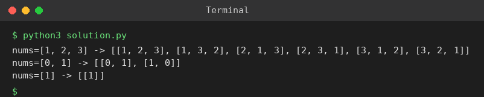

# Exp 89: Permutations

## Aim
To generate all permutations of an array of distinct integers.

## Algorithm
1. Backtrack: build the permutation position by position
2. Try every element that is not yet used
3. When the permutation has n elements record it
4. Un-choose the element and try the next one

## Input
```
nums = [1,2,3]
nums = [0,1]
nums = [1]
```

## Program
[`solution.py`](solution.py)

```python
def permute(nums):
    res, used, cur = [], [False] * len(nums), []
    def bt():
        if len(cur) == len(nums):
            res.append(cur[:])
            return
        for i, x in enumerate(nums):
            if not used[i]:
                used[i] = True
                cur.append(x)
                bt()
                cur.pop()
                used[i] = False
    bt()
    return res

for nums in ([1, 2, 3], [0, 1], [1]):
    print(f"nums={nums} -> {permute(nums)}")
```

## Output
```
nums=[1, 2, 3] -> [[1, 2, 3], [1, 3, 2], [2, 1, 3], [2, 3, 1], [3, 1, 2], [3, 2, 1]]
nums=[0, 1] -> [[0, 1], [1, 0]]
nums=[1] -> [[1]]
```

## Screenshot


## Result
The program for **Permutations** was implemented and executed successfully, and the output shown above was obtained for all the given test cases.

## Time and Space Complexity
| | Complexity |
|---|---|
| **Time** | O(n * n!) |
| **Space** | O(n) |
