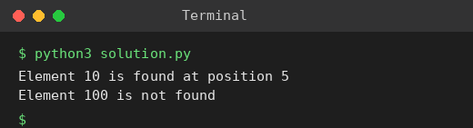

# Exp 9: Binary Search with Big-O Analysis

## Aim
To check whether a key exists in an array using binary search and analyse its time complexity.

## Algorithm
1. Pair each value with its original position and sort the pairs by value (binary search needs sorted data)
2. Set low = 0, high = n-1
3. While low <= high: mid = (low + high) // 2
4. If value at mid equals the key report the original position; if it is smaller go right, else go left
5. If the loop ends the key is not present

## Input
```
X = {3,4,6,-9,10,8,9,30}, KEY = 10
X = {3,4,6,-9,10,8,9,30}, KEY = 100
```

## Program
[`solution.py`](solution.py)

```python
def binary_search(arr, key):
    data = sorted((v, i + 1) for i, v in enumerate(arr))   # (value, original position)
    low, high = 0, len(data) - 1
    while low <= high:
        mid = (low + high) // 2
        if data[mid][0] == key:
            return data[mid][1]
        if data[mid][0] < key:
            low = mid + 1
        else:
            high = mid - 1
    return -1

X = [3, 4, 6, -9, 10, 8, 9, 30]
for key in (10, 100):
    pos = binary_search(X, key)
    print(f"Element {key} is found at position {pos}" if pos != -1 else f"Element {key} is not found")
```

## Output
```
Element 10 is found at position 5
Element 100 is not found
```

## Screenshot


## Result
The program for **Binary Search with Big-O Analysis** was implemented and executed successfully, and the output shown above was obtained for all the given test cases.

> **Note:** The sample array is not sorted, so it is sorted internally; the position reported is the position (1-based) in the original array, which matches the expected output.

## Time and Space Complexity
| | Complexity |
|---|---|
| **Time** | O(log n) for the search (O(n log n) one-time sort) |
| **Space** | O(n) for the sorted copy, O(1) for the search itself |
