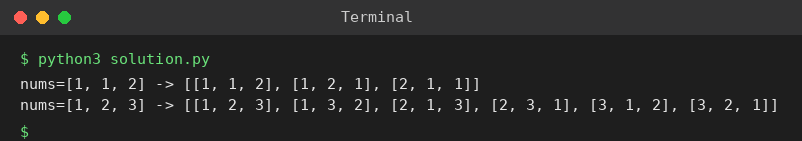

# Exp 90: Permutations II (with Duplicates)

## Aim
To generate all unique permutations of an array that may contain duplicates.

## Algorithm
1. Sort the array so equal values are adjacent
2. Backtrack position by position using a 'used' array
3. Skip nums[i] if it equals nums[i-1] and nums[i-1] is not used in the current path (prevents duplicates)
4. Record the permutation when complete

## Input
```
nums = [1,1,2]
nums = [1,2,3]
```

## Program
[`solution.py`](solution.py)

```python
def permute_unique(nums):
    nums = sorted(nums)
    res, used, cur = [], [False] * len(nums), []
    def bt():
        if len(cur) == len(nums):
            res.append(cur[:])
            return
        for i in range(len(nums)):
            if used[i] or (i > 0 and nums[i] == nums[i - 1] and not used[i - 1]):
                continue
            used[i] = True
            cur.append(nums[i])
            bt()
            cur.pop()
            used[i] = False
    bt()
    return res

for nums in ([1, 1, 2], [1, 2, 3]):
    print(f"nums={nums} -> {permute_unique(nums)}")
```

## Output
```
nums=[1, 1, 2] -> [[1, 1, 2], [1, 2, 1], [2, 1, 1]]
nums=[1, 2, 3] -> [[1, 2, 3], [1, 3, 2], [2, 1, 3], [2, 3, 1], [3, 1, 2], [3, 2, 1]]
```

## Screenshot


## Result
The program for **Permutations II (with Duplicates)** was implemented and executed successfully, and the output shown above was obtained for all the given test cases.

## Time and Space Complexity
| | Complexity |
|---|---|
| **Time** | O(n * n!) |
| **Space** | O(n) |
