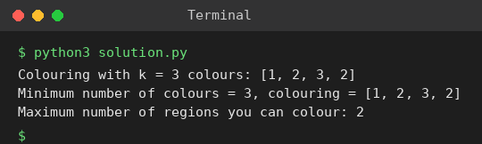

# Exp 91: Graph Colouring (Minimum Colours and Turn-taking Game)

## Aim
To colour a graph with the minimum number of colours using backtracking, and to find the maximum number of regions you colour when you, Alice and Bob colour in turns.

## Algorithm
1. m-colouring by backtracking: give vertex v a colour c that no neighbour uses, recurse to v+1, undo on failure
2. Try k = 1, 2, 3, ... and the first k that works is the minimum number of colours (chromatic number)
3. Turn-taking game: you, Alice and Bob colour one region each in rotation, so you get ceil(n / 3) regions

## Input
```
n = 4
edges = [(0,1),(1,2),(2,3),(3,0),(0,2)]
k = 3
```

## Program
[`solution.py`](solution.py)

```python
import math

def colour(n, edges, k):
    adj = [[] for _ in range(n)]
    for u, v in edges:
        adj[u].append(v)
        adj[v].append(u)
    col = [0] * n
    def bt(v):
        if v == n:
            return True
        for c in range(1, k + 1):
            if all(col[u] != c for u in adj[v]):
                col[v] = c
                if bt(v + 1):
                    return True
                col[v] = 0
        return False
    return col if bt(0) else None

n, edges, k = 4, [(0, 1), (1, 2), (2, 3), (3, 0), (0, 2)], 3
print("Colouring with k = 3 colours:", colour(n, edges, k))
for m in range(1, n + 1):
    c = colour(n, edges, m)
    if c:
        print(f"Minimum number of colours = {m}, colouring = {c}")
        break
print("Maximum number of regions you can colour:", math.ceil(n / 3))
```

## Output
```
Colouring with k = 3 colours: [1, 2, 3, 2]
Minimum number of colours = 3, colouring = [1, 2, 3, 2]
Maximum number of regions you can colour: 2
```

## Screenshot


## Result
The program for **Graph Colouring (Minimum Colours and Turn-taking Game)** was implemented and executed successfully, and the output shown above was obtained for all the given test cases.

## Time and Space Complexity
| | Complexity |
|---|---|
| **Time** | O(k^n) |
| **Space** | O(n) |
