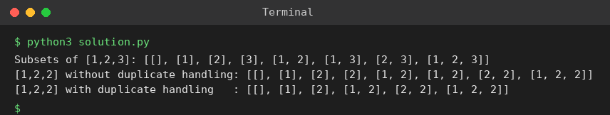

# Exp 94: Generate All Subsets in Lexicographic Order

## Aim
To generate all subsets of a set (ordered by size, then lexicographically) and to see how duplicates are handled.

## Algorithm
1. Sort the elements
2. Backtrack: record the current subset, then for every later element include it and recurse
3. To handle duplicates skip an element equal to the previous one at the same level
4. Order the result by (size, lexicographic)

## Input
```
A = [1,2,3]
A = [1,2,2] (duplicates)
```

## Program
[`solution.py`](solution.py)

```python
def subsets(a, dedupe=False):
    a = sorted(a)
    res = []
    def bt(start, cur):
        res.append(cur[:])
        for i in range(start, len(a)):
            if dedupe and i > start and a[i] == a[i - 1]:
                continue
            cur.append(a[i])
            bt(i + 1, cur)
            cur.pop()
    bt(0, [])
    return sorted(res, key=lambda s: (len(s), s))

print("Subsets of [1,2,3]:", subsets([1, 2, 3]))
print("[1,2,2] without duplicate handling:", subsets([1, 2, 2]))
print("[1,2,2] with duplicate handling   :", subsets([1, 2, 2], dedupe=True))
```

## Output
```
Subsets of [1,2,3]: [[], [1], [2], [3], [1, 2], [1, 3], [2, 3], [1, 2, 3]]
[1,2,2] without duplicate handling: [[], [1], [2], [2], [1, 2], [1, 2], [2, 2], [1, 2, 2]]
[1,2,2] with duplicate handling   : [[], [1], [2], [1, 2], [2, 2], [1, 2, 2]]
```

## Screenshot


## Result
The program for **Generate All Subsets in Lexicographic Order** was implemented and executed successfully, and the output shown above was obtained for all the given test cases.

## Time and Space Complexity
| | Complexity |
|---|---|
| **Time** | O(n * 2^n) |
| **Space** | O(n) recursion + output |
