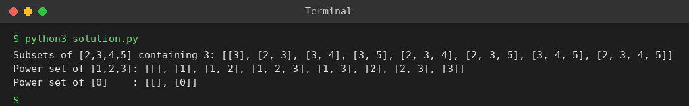

# Exp 95: Subsets Containing a Given Element and the Power Set

## Aim
To generate all subsets that contain a given element x and to generate the full power set of a set of unique integers.

## Algorithm
1. Remove x from the set and generate all subsets of the remaining elements by backtracking
2. Add x to each of them (every result contains x)
3. For the power set generate all subsets of the whole set
4. Order the outputs by size then lexicographically

## Input
```
E = [2,3,4,5], x = 3
nums = [1,2,3]
nums = [0]
```

## Program
[`solution.py`](solution.py)

```python
def power_set(a):
    a = sorted(a)
    res = []
    def bt(start, cur):
        res.append(cur[:])
        for i in range(start, len(a)):
            cur.append(a[i])
            bt(i + 1, cur)
            cur.pop()
    bt(0, [])
    return res

def subsets_with(a, x):
    rest = [v for v in a if v != x]
    return sorted((sorted(s + [x]) for s in power_set(rest)), key=lambda s: (len(s), s))

print("Subsets of [2,3,4,5] containing 3:", subsets_with([2, 3, 4, 5], 3))
print("Power set of [1,2,3]:", power_set([1, 2, 3]))
print("Power set of [0]    :", power_set([0]))
```

## Output
```
Subsets of [2,3,4,5] containing 3: [[3], [2, 3], [3, 4], [3, 5], [2, 3, 4], [2, 3, 5], [3, 4, 5], [2, 3, 4, 5]]
Power set of [1,2,3]: [[], [1], [1, 2], [1, 2, 3], [1, 3], [2], [2, 3], [3]]
Power set of [0]    : [[], [0]]
```

## Screenshot


## Result
The program for **Subsets Containing a Given Element and the Power Set** was implemented and executed successfully, and the output shown above was obtained for all the given test cases.

## Time and Space Complexity
| | Complexity |
|---|---|
| **Time** | O(n * 2^n) |
| **Space** | O(n * 2^n) for the output |
