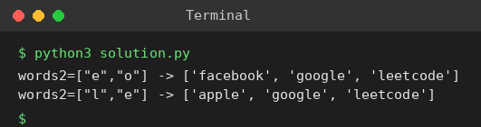

# Exp 96: Word Subsets (Universal Strings)

## Aim
To return the strings of words1 that contain every string of words2 as a subset (with letter multiplicity).

## Algorithm
1. For words2 compute, for every letter, the maximum count required by any single word
2. For each word in words1 count its letters
3. The word is universal if it has at least the required count for every letter
4. Collect the universal words

## Input
```
words1 = ["amazon","apple","facebook","google","leetcode"], words2 = ["e","o"]
words1 = same, words2 = ["l","e"]
```

## Program
[`solution.py`](solution.py)

```python
from collections import Counter

def word_subsets(words1, words2):
    need = Counter()
    for b in words2:
        for ch, c in Counter(b).items():
            need[ch] = max(need[ch], c)
    return [a for a in words1 if all(Counter(a)[ch] >= c for ch, c in need.items())]

w1 = ["amazon", "apple", "facebook", "google", "leetcode"]
print('words2=["e","o"] ->', word_subsets(w1, ["e", "o"]))
print('words2=["l","e"] ->', word_subsets(w1, ["l", "e"]))
```

## Output
```
words2=["e","o"] -> ['facebook', 'google', 'leetcode']
words2=["l","e"] -> ['apple', 'google', 'leetcode']
```

## Screenshot


## Result
The program for **Word Subsets (Universal Strings)** was implemented and executed successfully, and the output shown above was obtained for all the given test cases.

## Time and Space Complexity
| | Complexity |
|---|---|
| **Time** | O(total length of words1 + words2) |
| **Space** | O(1) (26 letters) |
