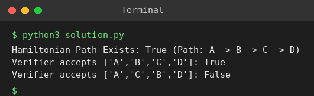

# Exp 97: P vs NP: Hamiltonian Path Verification

## Aim
To show that the Hamiltonian Path problem is in NP by implementing a polynomial-time verifier for a certificate (path), and a search that guesses certificates.

## Algorithm
1. Certificate = a sequence of vertices
2. Verifier (polynomial time): the sequence must contain every vertex exactly once and every consecutive pair must be an edge
3. Search: try every permutation of the vertices and run the verifier (simulates non-deterministic guessing)
4. Report True with the path if some certificate verifies

## Input
```
V = {A,B,C,D}
E = {(A,B),(B,C),(C,D),(D,A)}
```

## Program
[`solution.py`](solution.py)

```python
from itertools import permutations

def verify(edges, path, vertices):
    adj = {v: set() for v in vertices}
    for a, b in edges:
        adj[a].add(b)
        adj[b].add(a)
    return sorted(path) == sorted(vertices) and all(path[i + 1] in adj[path[i]] for i in range(len(path) - 1))

def find_path(vertices, edges):
    for p in permutations(vertices):
        if verify(edges, list(p), vertices):
            return list(p)
    return None

V = ["A", "B", "C", "D"]
E = [("A", "B"), ("B", "C"), ("C", "D"), ("D", "A")]
p = find_path(V, E)
print("Hamiltonian Path Exists:", p is not None, "" if p is None else f"(Path: {' -> '.join(p)})")
print("Verifier accepts ['A','B','C','D']:", verify(E, ["A", "B", "C", "D"], V))
print("Verifier accepts ['A','C','B','D']:", verify(E, ["A", "C", "B", "D"], V))
```

## Output
```
Hamiltonian Path Exists: True (Path: A -> B -> C -> D)
Verifier accepts ['A','B','C','D']: True
Verifier accepts ['A','C','B','D']: False
```

## Screenshot


## Result
The program for **P vs NP: Hamiltonian Path Verification** was implemented and executed successfully, and the output shown above was obtained for all the given test cases.

## Time and Space Complexity
| | Complexity |
|---|---|
| **Time** | Verifier O(V); finding a path by search O(V! * V) |
| **Space** | O(V) |
