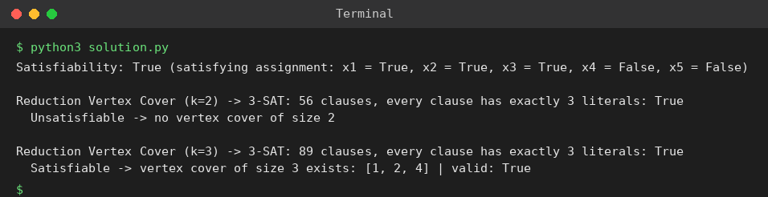

# Exp 98: 3-SAT and Reduction from Vertex Cover

## Aim
To solve a 3-SAT formula and to show NP-hardness by reducing Vertex Cover to 3-SAT (a cover of size k exists iff the generated 3-CNF formula is satisfiable).

## Algorithm
1. 3-SAT: solve the formula with DPLL (unit propagation + branching) and verify the assignment
2. Reduction: variable x(i,v) means 'slot i of the cover holds vertex v'; each slot holds exactly one vertex; every edge must have an end point in some slot
3. Convert long clauses into 3-literal clauses with auxiliary variables
4. Solve the generated formula: satisfiable iff a vertex cover of size k exists

## Input
```
3-SAT: (x1 v x2 v ~x3) ^ (~x1 v x2 v x4) ^ (x3 v ~x4 v x5)
Vertex Cover: V = {1,2,3,4,5}, E = {(1,2),(1,3),(2,3),(3,4),(4,5)}
```

## Program
[`solution.py`](solution.py)

```python
from itertools import combinations

def dpll(clauses, assign):
    while True:
        unit, new = None, []
        for c in clauses:
            if any(assign.get(abs(l)) == (l > 0) for l in c):
                continue
            rem = [l for l in c if abs(l) not in assign]
            if not rem:
                return None
            if len(rem) == 1:
                unit = rem[0]
            new.append(rem)
        clauses = new
        if unit is None:
            break
        assign[abs(unit)] = unit > 0
    if not clauses:
        return assign
    v = abs(clauses[0][0])
    for val in (True, False):
        a = dict(assign)
        a[v] = val
        r = dpll(clauses, a)
        if r is not None:
            return r
    return None

def vc_to_3sat(V, E, k):
    var = {}
    def x(i, v):
        if (i, v) not in var:
            var[(i, v)] = len(var) + 1
        return var[(i, v)]
    cnf = []
    for i in range(k):
        cnf.append([x(i, v) for v in V])
        for a, b in combinations(V, 2):
            cnf.append([-x(i, a), -x(i, b)])
    for u, v in E:
        cnf.append([x(i, u) for i in range(k)] + [x(i, v) for i in range(k)])
    nv, out = len(var), []
    for c in cnf:
        c = c[:]
        while len(c) > 3:
            nv += 1
            out.append([c[0], c[1], nv])
            c = [-nv] + c[2:]
        if len(c) == 2:
            nv += 1
            out += [c + [nv], c + [-nv]]
        else:
            out.append(c)
    return out, var

formula = [[1, 2, -3], [-1, 2, 4], [3, -4, 5]]
sol = dpll(formula, {})
sol = {i: sol.get(i, False) for i in range(1, 6)}
ok = all(any(sol[abs(l)] == (l > 0) for l in c) for c in formula)
print("Satisfiability:", ok, "(satisfying assignment:", ", ".join(f"x{i} = {v}" for i, v in sol.items()) + ")")

V, E = [1, 2, 3, 4, 5], [(1, 2), (1, 3), (2, 3), (3, 4), (4, 5)]
for k in (2, 3):
    cnf, var = vc_to_3sat(V, E, k)
    model = dpll(cnf, {})
    print(f"\nReduction Vertex Cover (k={k}) -> 3-SAT: {len(cnf)} clauses, every clause has exactly 3 literals: {all(len(c) == 3 for c in cnf)}")
    if model:
        cover = sorted({v for (i, v), idx in var.items() if model.get(idx)})
        print("  Satisfiable -> vertex cover of size", k, "exists:", cover, "| valid:", all(u in cover or w in cover for u, w in E))
    else:
        print("  Unsatisfiable -> no vertex cover of size", k)
```

## Output
```
Satisfiability: True (satisfying assignment: x1 = True, x2 = True, x3 = True, x4 = False, x5 = False)

Reduction Vertex Cover (k=2) -> 3-SAT: 56 clauses, every clause has exactly 3 literals: True
  Unsatisfiable -> no vertex cover of size 2

Reduction Vertex Cover (k=3) -> 3-SAT: 89 clauses, every clause has exactly 3 literals: True
  Satisfiable -> vertex cover of size 3 exists: [1, 2, 4] | valid: True
```

## Screenshot


## Result
The program for **3-SAT and Reduction from Vertex Cover** was implemented and executed successfully, and the output shown above was obtained for all the given test cases.

> **Note:** The smallest vertex cover of this graph has size 3 (for example {1, 2, 4} or {2, 3, 4}), so the formula for k = 2 is unsatisfiable and for k = 3 satisfiable. The sheet's exact cover {2, 4} does not cover edge (1,3).

## Time and Space Complexity
| | Complexity |
|---|---|
| **Time** | SAT solving is exponential in the worst case; the reduction is polynomial O(k * V^2 + k * E) |
| **Space** | O(k * V^2 + k * E) |
