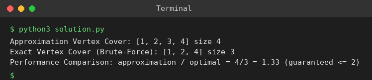

# Exp 99: Approximation Algorithm for Vertex Cover

## Aim
To implement the 2-approximation algorithm for Vertex Cover and compare it with the exact brute-force solution.

## Algorithm
1. Approximation: repeatedly pick an uncovered edge (u, v), add BOTH u and v to the cover, and ignore all edges touched by them (a maximal matching)
2. The result is at most 2 x the optimum
3. Exact: try all subsets of vertices in increasing size and return the first that covers all edges
4. Compare the sizes

## Input
```
G = (V, E), V = {1,2,3,4,5}, E = {(1,2),(1,3),(2,3),(3,4),(4,5)}
```

## Program
[`solution.py`](solution.py)

```python
from itertools import combinations

def approx_vc(E):
    cover = set()
    for u, v in E:
        if u not in cover and v not in cover:
            cover |= {u, v}
    return cover

def exact_vc(V, E):
    for k in range(len(V) + 1):
        for c in combinations(V, k):
            if all(u in c or v in c for u, v in E):
                return set(c)

V, E = [1, 2, 3, 4, 5], [(1, 2), (1, 3), (2, 3), (3, 4), (4, 5)]
a, e = approx_vc(E), exact_vc(V, E)
print("Approximation Vertex Cover:", sorted(a), "size", len(a))
print("Exact Vertex Cover (Brute-Force):", sorted(e), "size", len(e))
print(f"Performance Comparison: approximation / optimal = {len(a)}/{len(e)} = {len(a) / len(e):.2f} (guaranteed <= 2)")
```

## Output
```
Approximation Vertex Cover: [1, 2, 3, 4] size 4
Exact Vertex Cover (Brute-Force): [1, 2, 4] size 3
Performance Comparison: approximation / optimal = 4/3 = 1.33 (guaranteed <= 2)
```

## Screenshot


## Result
The program for **Approximation Algorithm for Vertex Cover** was implemented and executed successfully, and the output shown above was obtained for all the given test cases.

> **Note:** The sheet's exact cover {2, 4} misses edge (1,3), so it is not a cover; the true minimum cover has size 3 (found by brute force). The 2-approximation returns 4 vertices, which is within the guaranteed factor of 2.

## Time and Space Complexity
| | Complexity |
|---|---|
| **Time** | Approximation O(V + E); brute force O(2^V * E) |
| **Space** | O(V) |
